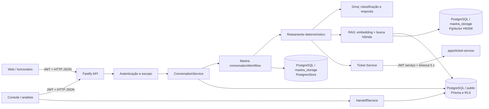
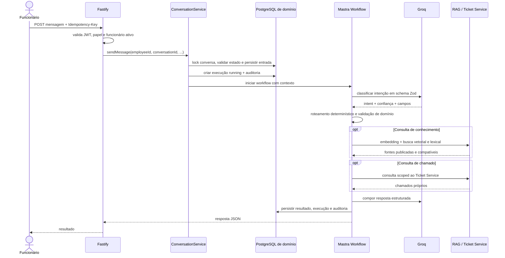
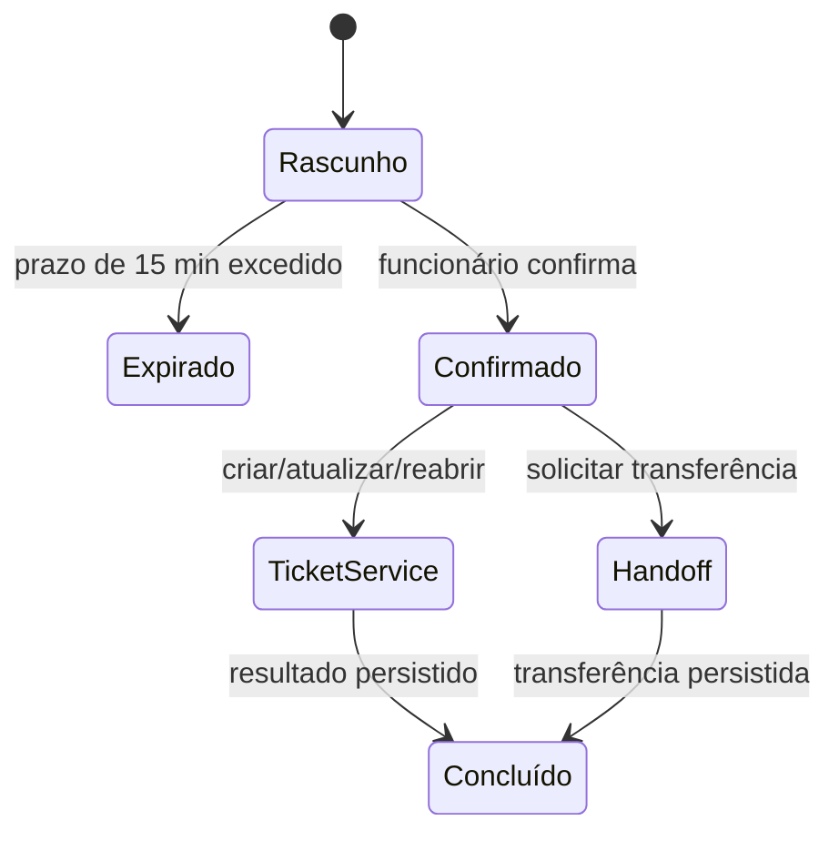
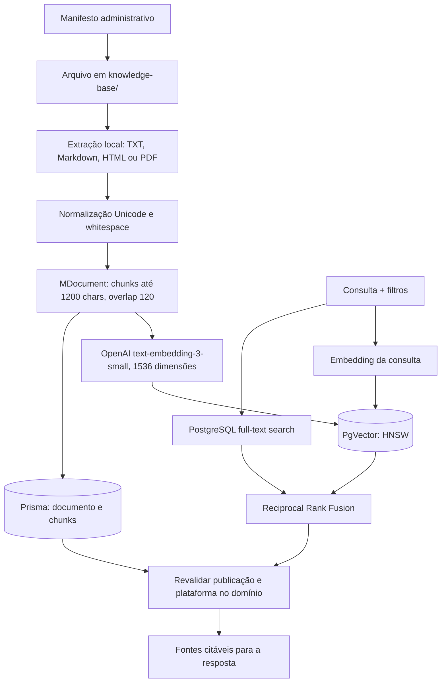

# Arquitetura do `nexo-assist-agent`

Este documento descreve o comportamento implementado em `apps/nexo-assist-agent`, não uma arquitetura futura do monorepo. O serviço usa Fastify para HTTP, Mastra para o agente/workflow/memória e PostgreSQL para estado de domínio, storage interno e índice vetorial.

## Contexto e componentes

### Responsabilidades

- **Fastify (`src/server.ts`)** declara rotas, valida requests, converte erros em respostas HTTP e fecha dependências.
- **Autenticação (`src/auth.ts`)** valida assinatura HS256, issuer, audience, papel, UUID do sujeito e status ativo no banco.
- **ConversationService** aceita mensagens de forma idempotente, persistindo a entrada antes de iniciar o workflow; confirma drafts e registra resultado/auditoria.
- **Mastra** registra o agente, workflow, tools, memória de mensagens recentes e `PostgresStore` em `src/mastra/index.ts`.
- **Agent runtime** classifica a intenção, consulta a dependência necessária, constrói um plano tipado e gera a resposta; as operações de escrita permanecem fora das tools do LLM até confirmação do funcionário.
- **Knowledge RAG** gera embeddings OpenAI, consulta `PgVector`, faz full-text search PostgreSQL e combina rankings por Reciprocal Rank Fusion.
- **Ticket Service** é chamado por HTTP com token de serviço e identidade do funcionário; regras de ownership, idempotência e versão pertencem a esse serviço.

## Turno de conversa

O `Idempotency-Key` identifica a entrada do funcionário e seu hash de conteúdo. Repetir a chave e o mesmo conteúdo devolve o resultado salvo; usar a chave com conteúdo diferente resulta em conflito. Uma conversa é bloqueada durante a aceitação/persistência de mensagens para serializar a sequência.

## Operações confirmadas

O draft e a resposta que o apresenta são persistidos juntos. A confirmação verifica estado e expiração, usa o ID estável do draft como chave idempotente na dependência externa e depois persiste o resultado. Banco do agente e Ticket Service não participam de uma transação distribuída; a garantia de repetição depende também da idempotência do serviço de chamados.

## RAG e publicação

- Apenas `knowledge_article` pode ser ingerido. O CLI bloqueia caminhos fora de `knowledge-base/`; tamanho máximo de arquivo: 30 MiB.
- Artigos novos começam como `draft`. A publicação e o arquivamento de versões anteriores alteram metadados do domínio e dos vetores.
- A recuperação final consulta novamente o banco de domínio e descarta resultados sem documento publicado ou com plataforma incompatível. Sem plataforma na consulta, somente conteúdo global é elegível.
- Os vetores e os chunks de domínio são gravados em operações distintas. Um erro parcial pode exigir nova execução do manifesto com `reindex: true`; o estado de publicação no banco de domínio continua sendo o filtro de recuperação final.
- Embeddings usam OpenAI; classificação, resposta e juiz de avaliação usam o modelo Groq configurado.

## Persistência e consistência

| Dados                                                                  | Dono                    | Local                                                        |
| ---------------------------------------------------------------------- | ----------------------- | ------------------------------------------------------------ |
| Conversas, mensagens, drafts, handoffs, auditoria, documentos e chunks | Prisma                  | PostgreSQL, schema `public`                                  |
| Memória de agente e estado interno de workflow                         | Mastra `PostgresStore`  | PostgreSQL, schema `mastra_storage`                          |
| Vetores RAG                                                            | `@mastra/pg` `PgVector` | PostgreSQL/pgvector, schema `mastra_storage`                 |
| Tickets                                                                | Ticket Service          | PostgreSQL do serviço, fora do escopo de transação do agente |

O schema de domínio e o storage Mastra compartilham instância PostgreSQL, mas não as tabelas nem o proprietário de migrations. `DATABASE_URL` é de runtime; `DIRECT_URL` é reservado às migrations. Os escopos do pacote database configuram as transações usadas com RLS.

## Observabilidade

Cada turno tem `traceId`, execução persistida, uso de tokens quando fornecido pelo provedor, durações, eventos auditáveis e referências de fontes. O filtro de saída Mastra e as funções de resumo removem campos sensíveis conhecidos, endereços de e-mail, CPF, telefones e raciocínio privado. A auditoria operacional redige texto e limita o tamanho de resumos; não é um sistema de métricas externo nem um substituto para uma política formal de retenção.

## Trade-offs e limitações conhecidas

| Escolha                                        | Benefício                                    | Custo/limitação                                                           |
| ---------------------------------------------- | -------------------------------------------- | ------------------------------------------------------------------------- |
| Classificação e resposta em chamadas separadas | Roteamento controlado e saída estruturada    | Duas chamadas LLM por turno, maior custo e latência                       |
| Busca vetorial + lexical com RRF               | Boa cobertura semântica e termos exatos      | Embedding por consulta e duas fontes de busca elevam latência/custo       |
| Groq para geração e OpenAI para embeddings     | Mantém modelos e índice atuais               | Duas credenciais/provedores; sem fallback configurado                     |
| PostgreSQL compartilhado com schemas distintos | Operação local simples e ownership explícito | Banco é domínio comum de falha/capacidade                                 |
| Draft + confirmação + idempotência             | Evita escrita acidental e permite repetição  | Sem atomicidade distribuída entre agente e Ticket Service                 |
| Resposta Fastify JSON                          | Fluxo simples e persistido                   | Não entrega streaming de tokens                                           |
| Timeout fixo de 5 s para Ticket Service        | Limita chamadas pendentes                    | Não é ajustável via ambiente; retry/circuit breaker não configurados aqui |
| Compose local apenas                           | Ambiente de desenvolvimento reprodutível     | Não há Dockerfile de aplicação, TLS, HA ou deploy de produção no pacote   |
| Avaliação RAG com juiz LLM                     | Mede groundedness, relevância e cobertura    | Custo variável, não totalmente determinística e sem thresholds de release |

Limitações adicionais: não há endpoint de emissão de JWT; depende de um emissor externo. Não há limites de taxa configurados neste serviço. A avaliação de RAG exige corpus já indexado e acesso ao provedor de embeddings e ao modelo julgador. Feriados/timezone de SLA, política de retenção de auditoria, thresholds de recuperação e estratégia de fallback de provedores ainda precisam de decisão operacional.

## Execução e verificação

Consulte [README](../README.md) para configuração, rotas, ingestão e comandos. O [relatório de validação](./VALIDATION.md) contém os resultados verificados desta revisão.
