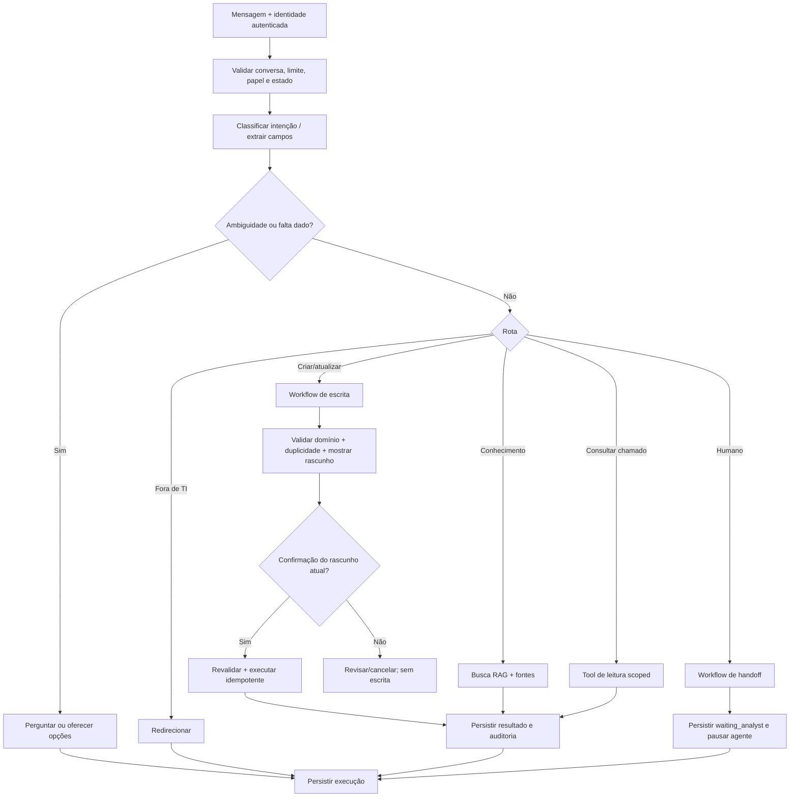

# Desenho do agente e workflows

**Projeto Mastra:** `nexo-assist-agent`  
**Referências:** [PRD](../PRD.md) · [API](./API_CONTRACTS.md) · [Modelo de dados](./DATA_MODEL.md)

## 1. Estratégia

MVP com **um agente principal**, tools especializadas e workflows determinísticos. Não há justificativa no PRD para multiagentes; a decomposição em agentes aumentaria custo, latência e superfície de autorização sem resolver um problema demonstrado.

O LLM interpreta linguagem, extrai dados, propõe intenção e redige respostas. Serviços e workflows verificam autorização, completude, ownership, duplicidade, prioridade, SLA, confirmação e transições. O agente não pode contornar as verificações chamando tools diretamente.

## 2. Ciclo de decisão

## 3. Intenções

`KNOWLEDGE_QUERY`, `TICKET_CREATE`, `TICKET_UPDATE`, `TICKET_STATUS`, `TICKET_REOPEN`, `HUMAN_HANDOFF`, `OUT_OF_SCOPE`, `CLARIFICATION`.

A classificação é uma sugestão estrutural validada por schema. A intenção não concede permissão nem executa ação. Pedidos fora de TI são redirecionados conforme o PRD.

## 4. Tools e limites

| Tool lógica               | Acesso            | Autorização/regra fora do LLM                                                                                        |
| ------------------------- | ----------------- | -------------------------------------------------------------------------------------------------------------------- |
| `searchKnowledgeBase`     | Leitura           | Apenas documentos publicados; retorna evidências e referências.                                                      |
| `listMyTickets`           | Leitura           | Identidade do chamador injetada no servidor; sem owner arbitrário.                                                   |
| `getMyTicket`             | Leitura           | Busca por ticket ID e proprietário em uma operação.                                                                  |
| `findDuplicateCandidates` | Leitura           | Busca somente tickets elegíveis do mesmo funcionário; retorna candidatos para workflow.                              |
| `prepareTicketDraft`      | Sem escrita       | Valida os campos e gera preview imutável/versionado; verifica candidato de duplicidade.                              |
| `commitTicketDraft`       | Escrita           | Exige confirmação explícita do funcionário vinculada ao draft ID/hash, revalida regra e ownership, usa idempotência. |
| `requestHandoff`          | Escrita de estado | Verifica critérios/solicitação, persiste resumo e pausa agente atomicamente.                                         |
| `analystTakeover`         | Ação analista     | Papel analista; atribuição concorrente atômica.                                                                      |
| `returnToAgent`           | Ação analista     | Papel analista atribuído; retorna a conversa a active.                                                               |
| `closeConversation`       | Ação analista     | Papel autorizado; registra encerramento.                                                                             |

As ferramentas não usam `employeeId` vindo do modelo como fonte de identidade. Campos extraídos pelo modelo são dados não confiáveis e validados por Zod e domínio.

## 5. Workflows

### Consultar conhecimento

1. Detectar pergunta relacionada a TI.
2. Consultar RAG com filtros de artigo publicado, plataforma/versão quando conhecida.
3. Se a evidência passar critérios calibrados, responder com fonte e ressalvas.
4. Se faltar plataforma ou contexto importante, perguntar; se não houver evidência suficiente, declarar limitação e oferecer handoff/chamado.
5. Auditar documentos/chunks usados e resultado.

### Consultar chamados

1. Obter proprietário da sessão autenticada.
2. Listar chamados próprios e resumir status, prioridade e prazo.
3. Se houver várias opções, mostrar seleção breve; não exigir número conhecido.
4. Abrir detalhe somente após seleção, mantendo verificação de ownership.
5. Oferecer analista para vencido conforme PRD; não realizar update sem draft e confirmação.

### Criar ou atualizar chamado

1. Coletar título, descrição, tipo, categoria, prioridade e pessoa afetada; perguntar campos faltantes.
2. Determinar impacto/urgência conforme evidência; solicitar informação se insuficiente.
3. Consultar candidatos de duplicidade do proprietário.
4. Se um chamado aberto representar o mesmo problema, preparar atualização em vez de novo ticket. Se resolvido há no máximo sete dias, oferecer reabertura. Fora da janela ou resultado ambíguo, não reabrir automaticamente; esclarecer ou transferir.
5. Calcular prazo conforme regra de SLA configurada e mostrar rascunho completo, indicando se será criação, atualização ou reabertura.
6. Esperar confirmação explícita vinculada a esse rascunho. “Sim” a outra pergunta, conteúdo editado ou draft expirado não conta como confirmação.
7. Revalidar papel, ownership, estado, draft e duplicidade; executar com idempotency key.
8. Persistir ticket/histórico no Ticket Service e trilha de auditoria no AI Backend; informar o resultado real.

### Handoff

Acionado por pedido do funcionário, caso crítico, chamado vencido ou segurança insuficiente. Gera resumo factual com problema, tentativas, fontes, ticket relacionado e perguntas pendentes; evita inferências como fatos. Persiste handoff e pausa o agente. Falha ao criar handoff não pode ser apresentada como transferência concluída.

### Atendimento por analista

O console em `/analyst` lista handoffs pendentes e atribuídos, exibe resumo factual, conversa e trilha de eventos, e permite assumir, responder, retomar o agente, resolver ou encerrar. A API fica em `/api/v1/analyst/handoffs`; exige JWT assinado pelo issuer/audience do backend com `role: analyst` e `sub` correspondente a um analista ativo.

Estados válidos do handoff: `waiting_analyst → analyst_assigned → agent_resumed → resolved → closed`, com `analyst_assigned → resolved|closed`, `agent_resumed → closed` e `resolved → closed` também permitidos. A atribuição usa compare-and-set no banco e índice único parcial para impedir dois analistas simultâneos. Enquanto aguarda ou está atribuído, o agente pausa. Retomar altera o estado da conversa e libera novas respostas do agente. Cada solicitação, atribuição, mensagem e transição persiste ator, instante e motivo em `HandoffEvent`.

O resumo é montado das mensagens recentes da conversa, com rótulos de autoria e sem inferências. Solicitação explícita, baixa confiança, chamado crítico e chamado vencido são encaminhados via draft confirmado pelo funcionário; após confirmação, o handoff é persistido e o agente é pausado. Falha de persistência não é apresentada como transferência concluída.

## 6. Confirmação e segurança de escrita

- Confirmação antes de **toda** criação ou atualização de ticket; reabertura e qualquer operação que altere ticket também exigem preview e confirmação por consistência.
- O draft exibe todos os campos, solicitante/afetado, prioridade e prazo, e a operação que ocorrerá.
- Confirmação é explícita, recente e vinculada a `draftId`/versão; editar invalida confirmação anterior.
- Tool de escrita verifica a confirmação no servidor, não confia em texto de prompt, saída do modelo ou botão do navegador isoladamente.
- Requisições de escrita aceitam idempotência; resposta repetida retorna o resultado original, nunca cria duplicata.

## 7. Memória e contexto

Identidade + `conversationId` autenticado formam a chave de escopo. A memória de Mastra ajuda continuidade linguística, mas não é fonte para status de ticket, autorização, confirmação ou fatos atuais. Recuperar mensagens persistidas conforme janela/contexto limitada e consultar novamente ferramentas para fatos transacionais.

No limite de 30 mensagens do funcionário, não aceitar nova mensagem na mesma conversa; manter leitura/histórico disponível e oferecer nova conversa. Estado do agente e handoff sempre prevalecem sobre memory.

## 8. Transparência e confiança

Persistir para cada execução: intenção estruturada, ferramenta/workflow escolhido, estado, referências de fonte, validações relevantes, resumo do resultado, motivo curto, nível de confiança operacional quando calibrado, duração, uso do modelo e `traceId`. Não persistir chain-of-thought. A interface distingue ação planejada, executada, falha e aguardando confirmação.

Os motivos exibidos e persistidos como justificativas de execução são sínteses operacionais determinísticas (intenção, ferramenta, estado e evidências), nunca a justificativa textual produzida pelo classificador. Eventos e spans são redigidos para remover PII e segredos; a consulta autenticada é limitada ao funcionário proprietário da conversa.

Até calibração com testes, confiança numérica do modelo não é probabilidade confiável. Handoff/clarificação devem decorrer de critérios observáveis: campos ambíguos, evidência RAG insuficiente, falha de ferramenta e classificação não validada.

## 9. Restrições de resposta

- Responder em português brasileiro, com linguagem direta e acessível.
- Não inventar estado de ticket, solução técnica, prazo ou resultado.
- Citar base/fonte quando instrução vem do RAG.
- Não expor conteúdo de outro funcionário.
- Não afirmar sucesso antes do serviço persistir a operação.
- Não responder como agente durante atendimento humano atribuído.
- Não ocultar falhas de dependência.
