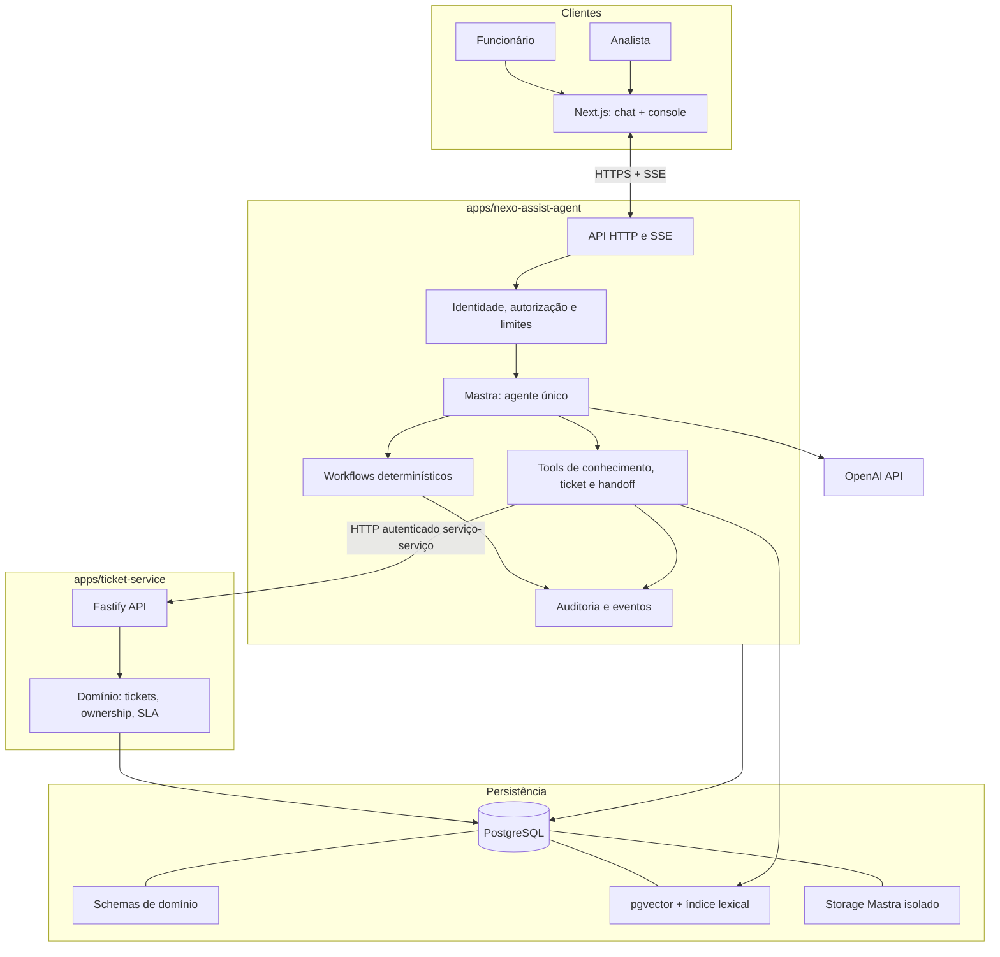
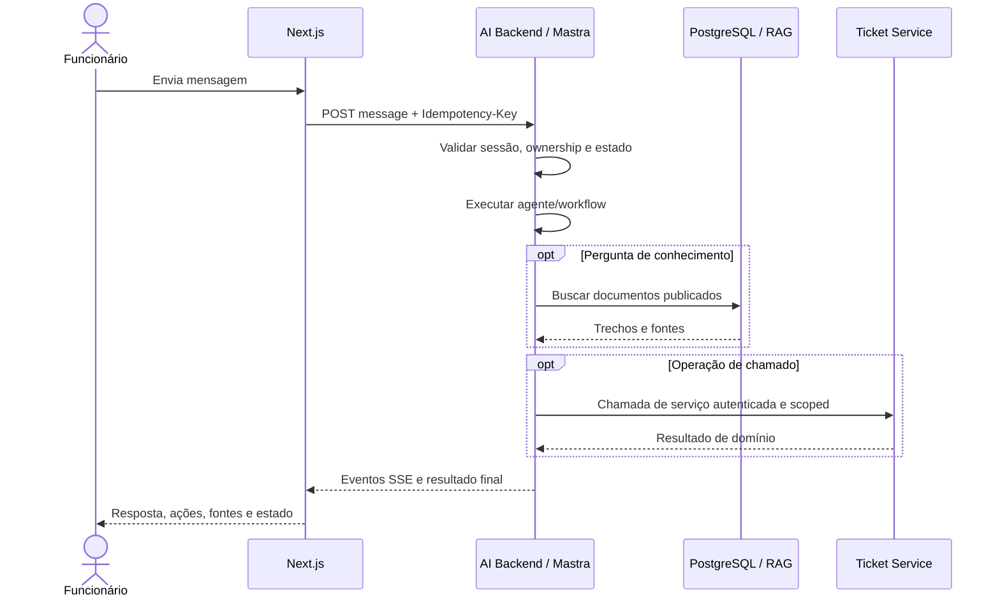

# Arquitetura — Nexo Assist

**Projeto Mastra:** `nexo-assist-agent`  
**Referência funcional:** [PRD](../PRD.md) · [SDD](./SDD.md)

## 1. Contexto

O protótipo atende funcionários e analistas por uma interface Next.js. O AI Backend, implementado com Mastra, interpreta solicitações e coordena ferramentas/workflows. Um Ticket Service independente, implementado com Fastify, executa as regras de chamados. PostgreSQL armazena dados transacionais e pgvector atende a recuperação de conhecimento.



## 2. Componentes e responsabilidades

### `apps/web` — Next.js

- Login demonstrativo, chat, cards/seleção de chamados, rascunho de confirmação e estado da conversa.
- Console do analista: filtros, fila, histórico, painel de chamados do funcionário, ações de assumir/devolver/encerrar.
- Apresentação de eventos do agente e erros; não decide autorização ou regras.
- Não chama o Ticket Service diretamente.

### `apps/nexo-assist-agent` — Mastra + API

- API de conversas e de console; autenticação de demonstração e autorização baseada em identidade/papel.
- Um agente Mastra, ferramentas especializadas e workflows com etapas determinísticas.
- Orquestra RAG, chamada autenticada ao Ticket Service, streaming, memória e auditoria.
- Mantém conversas, mensagens, handoffs e execuções; é a fonte de verdade do estado conversacional.

### `apps/ticket-service` — Fastify

- API isolada e domínio de funcionários seed, chamados, histórico, busca de duplicidade, SLA e idempotência.
- Obtém o funcionário/papel da identidade serviço-a-serviço validada; nunca confia em `employeeId` escolhido pelo cliente.
- Não importa Mastra nem processa prompts.

### `packages/contracts`

Schemas Zod e tipos compartilhados de requests, responses, erros e eventos. O compartilhamento de contratos não implica compartilhar regras ou acesso a tabelas.

### `packages/database`

Convenções de conexão, clientes tipados e migrations conforme ownership. Para evitar migrações concorrentes, cada serviço aplica e mantém suas migrations de domínio; storage Mastra permanece separado.

### Base de conhecimento

Conteúdo aprovado de TI e pipeline de indexação versionado. Não contém conversas ou tickets como corpus.

## 3. Organização lógica sugerida

```text
apps/
  web/
  nexo-assist-agent/
    src/{http,mastra/agents,mastra/tools,mastra/workflows,modules,rag}
  ticket-service/
    src/{http,modules/employees,modules/tickets,modules/sla}
packages/
  contracts/
  database/
  domain/
  config/
  shared/
knowledge-base/
  access/
  network/
  hardware/
  software/
  policies/
```

A estrutura é uma decisão inicial, não requisito do PRD. Responsabilidades e dependências são mais importantes do que nomes de pastas.

## 4. Persistência e ownership

Um PostgreSQL local com extensão pgvector atende o protótipo. Schemas separados e credenciais por serviço limitam acoplamento:

| Schema físico    | Proprietário | Conteúdo                                                                    |
| ---------------- | ------------ | --------------------------------------------------------------------------- |
| `public`         | Prisma       | Tabelas de domínio: funcionário, conversa, ticket, execução, auditoria, RAG |
| `mastra_storage` | Mastra       | Estado técnico de memória e workflows, gerenciado pelo `PostgresStore`      |

Prisma é o ORM para dados de domínio; `@mastra/pg`/`PostgresStore` é a integração de storage do Mastra. Eles não devem compartilhar tabelas. A escolha de suporte de pgvector e SQL tipado deve ser validada contra as versões fixadas na implementação; SQL especializado fica encapsulado no repositório RAG.

As tabelas de domínio privadas usam Row-Level Security forçada e FKs compostas com `employeeId`. O papel de runtime não tem `SUPERUSER` nem `BYPASSRLS`; o backend configura o contexto autenticado com `withEmployeeScope` em cada transação. RLS é defesa em profundidade e não substitui autenticação nem autorização de aplicação. `DIRECT_URL` é reservado às migrations.

## 5. Comunicação e fluxo



O Next.js não mantém a única cópia do estado de execução. Eventos têm IDs sequenciais por conversa para recuperação após reconexão. Respostas e erros finais são persistidos antes de serem apresentados como concluídos.

## 6. Resiliência

- Timeout configurável por chamada a serviços externos.
- Retry com limite e backoff apenas para falhas transitórias de leitura; escrita exige chave de idempotência estável.
- Circuit breaker é opção de evolução se métricas demonstrarem indisponibilidade persistente.
- Não converter timeout ou falha em ticket inexistente, sucesso, resposta RAG vazia ou handoff concluído.
- Em falha do Ticket Service, preservar contexto, informar usuário e oferecer tentativa posterior ou analista.

## 7. Segurança

- O protótipo aceita qualquer senha somente para e-mails seed do PRD. Isso é modo local/demonstração, isolado e explicitamente desativado em produção.
- Em produção, substituir pelo provedor corporativo/OIDC antes de expor a aplicação; não há política corporativa de autenticação especificada no PRD.
- Papel `employee` ou `analyst` é obtido de sessão autenticada no servidor.
- Token de serviço distingue o AI Backend do Ticket Service; tráfego usa TLS fora do ambiente local.
- Limitação de taxa e tamanho de entrada, proteção CSRF conforme tipo de sessão e segredos somente em variáveis/secret manager.
- Conteúdo recuperado ou fornecido por usuário é dado não confiável; não pode alterar políticas nem provocar tools sem validação.

## 8. Observabilidade

Correlacionar `requestId`, `traceId`, `conversationId` e `executionId`. Registrar tempos, estado e erros, chamadas a tools, fontes de RAG, decisão de handoff e identificador do chamado criado/atualizado. Não registrar senha, token, conteúdo sensível desnecessário nem raciocínio interno privado do LLM.

## 9. Stack e notas de compatibilidade

TypeScript strict, pnpm/Turborepo, Next.js, Fastify, Mastra, PostgreSQL, pgvector, Prisma, Zod, OpenAI e Docker Compose são a stack de referência indicada pelo solicitante. O pacote Mastra existente no workspace é um starter genérico; suas capabilities de workspace, shell, agendamento, modelo Groq e storage local não fazem parte do produto e devem ser substituídas na implementação.

Para desenho versionado, consultar [documentação PostgreSQL do Mastra](https://mastra.ai/docs/memory/storage), [Prisma e extensões](https://www.prisma.io/docs/orm/extensions) e [pgvector](https://github.com/pgvector/pgvector). Fixar dependências e validar APIs antes de implementar; esta arquitetura não presume compatibilidade entre versões.
