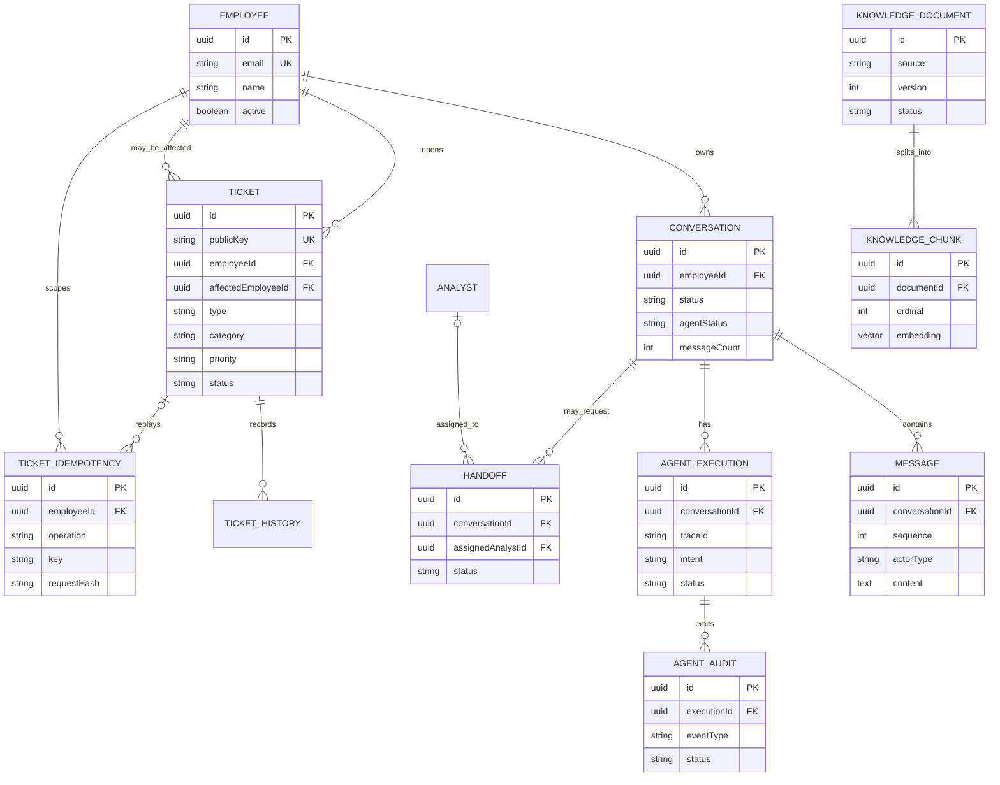
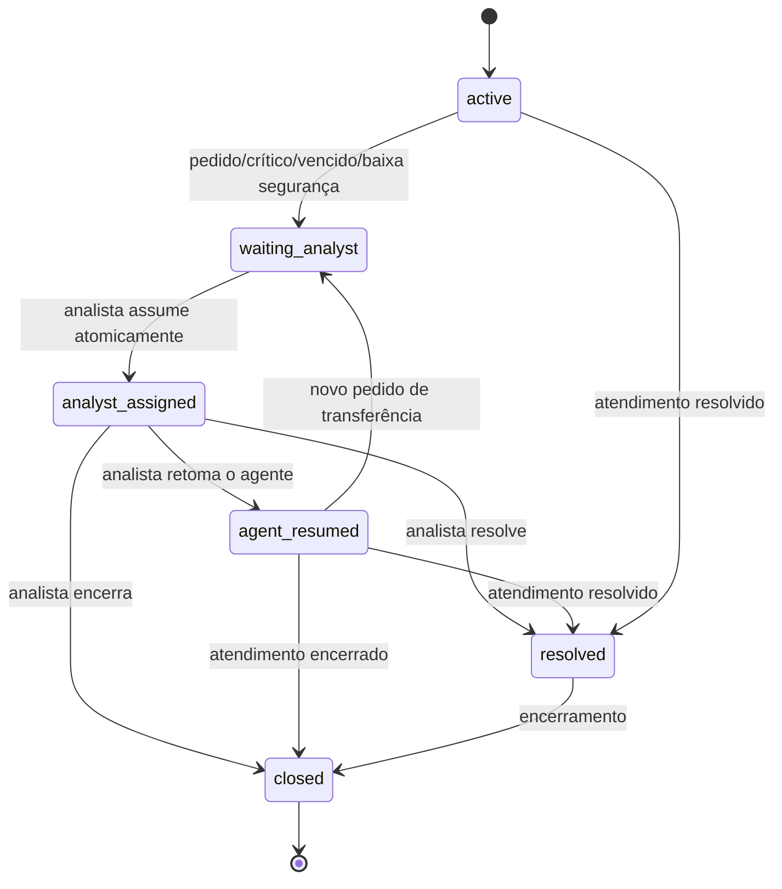

# Modelo de dados — Nexo Assist

**Fonte funcional:** [PRD](../PRD.md) · **Arquitetura:** [ARCHITECTURE](./ARCHITECTURE.md)

## 1. Princípios

- PostgreSQL é a fonte de verdade para domínio, conversa, auditoria e conhecimento.
- O Ticket Service é proprietário de funcionários de demonstração e tickets; o AI Backend é proprietário das conversas e execuções.
- O storage do Mastra é separado e não substitui mensagens/auditoria de domínio.
- IDs são opacos (UUID/ULID); timestamps são UTC e apresentados em timezone de negócio configurado.
- Toda leitura de chamado é escopada ao funcionário autenticado; toda mutação confirma ownership novamente no serviço dono do dado.
- Não indexar tickets, mensagens ou dados pessoais no RAG institucional.

## 2. Entidades

| Entidade            | Campos principais                                                                                                                                                                     | Regras/índices                                                                                                        |
| ------------------- | ------------------------------------------------------------------------------------------------------------------------------------------------------------------------------------- | --------------------------------------------------------------------------------------------------------------------- |
| `Employee`          | `id`, `email`, `name`, `department?`, `active`, `createdAt`                                                                                                                           | Unique de email case-insensitive; RLS por `id`.                                                                       |
| `Analyst`           | `id`, `email`, `name`, `active`                                                                                                                                                       | Papel distinto; atribuições de handoff.                                                                               |
| `Conversation`      | `id`, `employeeId`, `status`, `agentStatus`, `messageCount`, `createdAt`, `updatedAt`, `closedAt?`                                                                                    | Índice por `(employeeId, status, updatedAt)`; RLS e FK composta por funcionário.                                      |
| `Message`           | `id`, `employeeId`, `conversationId`, `sequence`, `actorType`, `actorId?`, `content`, `createdAt`, `metadata?`, `idempotencyKey?`                                                     | Unique `(conversationId, sequence)` e `(employeeId, idempotencyKey)`; FK composta e RLS.                              |
| `Ticket`            | `id`, `publicKey`, `employeeId`, `affectedEmployeeId`, `title`, `description`, `type`, `category`, `priority`, `status`, `createdAt`, `updatedAt`, `resolvedAt?`, `dueAt?`, `version` | `publicKey` único; índices por proprietário/status e vencimento. `affectedEmployeeId` não concede acesso.             |
| `TicketHistory`     | `id`, `employeeId`, `ticketId`, `actorType`, `actorId?`, `action`, `changes`, `createdAt`, `idempotencyKey?`, `requestHash?`                                                          | FK composta e RLS; unique de idempotência e índice por ticket/data.                                                   |
| `TicketIdempotency` | `id`, `employeeId`, `operation`, `key`, `requestHash`, `ticketId?`, `response?`, `createdAt`, `completedAt?`                                                                          | Unique `(employeeId, operation, key)`; mesma chave com payload divergente é conflito.                                 |
| `Handoff`           | `id`, `employeeId`, `conversationId`, `status`, `reason`, `summary`, `requestedAt`, `assignedAnalystId?`, `assignedAt?`, `completedAt?`                                               | FK composta e RLS; índice único parcial permite somente um handoff `waiting_analyst`/`analyst_assigned` por conversa. |
| `HandoffEvent`      | `id`, `employeeId`, `handoffId`, `action`, `actorType`, `actorId`, `reason`, `metadata?`, `createdAt`                                                                                 | Histórico imutável de operações; autoria, horário e motivo obrigatórios.                                              |
| `AgentExecution`    | `id`, `employeeId`, `conversationId`, `traceId`, `intent`, `status`, `confidence?`, `reason?`, `startedAt`, `completedAt?`, `model?`, `usage?`                                        | FK composta e RLS; unique `(employeeId, traceId)` e índices por conversa/tempo.                                       |
| `AgentAudit`        | `id`, `employeeId`, `executionId`, `eventType`, `toolName?`, `inputSummary?`, `outputSummary?`, `status`, `sourceRefs?`, `createdAt`                                                  | FK composta e RLS; não incluir segredo ou chain-of-thought.                                                           |
| `KnowledgeDocument` | `id`, `source`, `title`, `category`, `version`, `status`, `platforms`, `tags`, `updatedAt`, `contentHash`                                                                             | Unique `(source, version)` ou chave equivalente; somente `published` recuperável.                                     |
| `KnowledgeChunk`    | `id`, `documentId`, `ordinal`, `content`, `tokenCount`, `embedding vector(1536)`, `metadata`                                                                                          | Unique `(documentId, ordinal)`; dimensão alinhada ao embedding escolhido.                                             |

### Distinção de solicitante e afetado

O PRD exige identificar “de quem é afetado” no chamado e também exige privacidade para quem o abriu. Portanto, `employeeId`/solicitante e `affectedEmployeeId` são conceitos distintos. Na experiência do funcionário do MVP, o afetado pode ser o próprio solicitante; informar terceiro não concede acesso ao chamado.

### Conversa e mensagens

`actorType` assume `employee`, `assistant`, `analyst` ou `system`. Mensagens de ação usam metadata estruturada apontando para `executionId`; a transcrição continua legível mesmo sem visualizador de auditoria. Dados técnicos de SSE não são mensagens persistidas.

## 3. Relacionamentos

`Analyst` e `Handoff` são propriedade do AI Backend. `Employee`, `Ticket`, histórico e idempotência pertencem ao Ticket Service. No monólito de banco do protótipo, relações entre schemas podem ser referências por ID sem FK cross-service; o contrato do serviço valida existência/ownership quando necessário.

## 4. Enums e estados

### Chamado (valores fixos do PRD)

- Tipo: `INC` (incidente), `REQ` (requisição).
- Categoria: `Acesso`, `Rede e VPN`, `Hardware`, `Software`, `E-mail`, `Outros`.
- Prioridade: `Crítica`, `Alta`, `Média`, `Baixa`.
- Estado: PRD não define enumeração completa. Serviço simulado deve suportar pelo menos aberto, aguardando analista, resolvido e encerrado, preservando estados representados nos dados de exemplo e documentando o mapeamento. Não inferir que “Aprovado” é encerrado ou resolvido.

### Conversa e agente

`Conversation.status`: `active | waiting_analyst | analyst_assigned | agent_resumed | resolved | closed`.
`agentStatus`: `active | paused | completed`. `waiting_analyst` e `analyst_assigned` implicam `paused`; validação de domínio impede combinações inválidas. O agente só retoma por transição autorizada.

`Handoff.status`: `waiting_analyst | analyst_assigned | agent_resumed | resolved | closed`. Transições inválidas são rejeitadas no backend. A atribuição é uma atualização condicional atômica e o índice único parcial impede mais de um atendimento ativo por conversa. `HandoffEvent` registra ator, instante e motivo de cada solicitação, atribuição, mensagem e transição.

## 5. SLA e prioridade

Armazenar prioridade atribuída e instante limite calculado (`dueAt`), além do instante e dados necessários para explicar o cálculo. Critérios fornecidos pelo PRD: crítica — equipe/empresa parada, uma hora; alta — uma pessoa impedida ou compromisso no mesmo dia, quatro horas úteis; média — há alternativa, três dias úteis; baixa — pedido/melhoria sem urgência, cinco dias úteis. SLA vencido é comparação do relógio atual com prazo persistido.

Calendário, feriados, timezone, pausas por status e regra de atualização são questões abertas no [SDD](./SDD.md), portanto o MVP não deve alegar precisão maior que as regras configuradas.

## 6. Invariantes de consistência e privacidade

1. `Conversation.employeeId` vem da sessão; toda rota valida dono da conversa.
2. Consultas de ticket usam `id + employeeId` (ou API equivalente), não `id` isolado.
3. `affectedEmployeeId` não altera ownership nem autorização de leitura.
4. Uma escrita usa chave idempotente; o ticket e o registro de histórico são persistidos atomicamente pelo Ticket Service.
5. A criação/atualização só acontece após confirmação inequívoca do rascunho vigente e autorização novamente validada.
6. Contador de mensagens do funcionário é atualizado atomicamente e não ultrapassa 30 por conversa.
7. Handoff ativo impede nova execução de resposta do agente; mudanças de estado usam comparação/versionamento para prevenir corrida.
8. Exclusão ou retenção de conteúdo segue política de privacidade definida antes de produção; logs técnicos evitam duplicar conteúdo integral.

### Isolamento no PostgreSQL

As tabelas de funcionário e dados de domínio associados (`Conversation`, `Message`, `Ticket`, `TicketHistory`, `TicketIdempotency`, `AgentExecution`, `AgentAudit`, `Handoff` e `HandoffEvent`) usam Row-Level Security com `FORCE ROW LEVEL SECURITY`. O papel de runtime não tem `SUPERUSER` nem `BYPASSRLS`. Cada transação de funcionário usa `withEmployeeScope`/`app.employee_id`; operações do console passam por políticas restritas a `withAnalystScope`/`app.analyst_id`, permitindo apenas a fila de handoffs e conversas associadas, e mensagens somente quando o analista está atribuído. Chaves estrangeiras compostas repetem `employeeId` nas relações privadas para impedir referências cruzadas entre funcionários. A identidade usada no escopo deve vir exclusivamente do contexto autenticado pelo backend.

`DATABASE_URL` é a conexão de runtime; `DIRECT_URL` é a conexão privilegiada usada pelas migrations. O Prisma gerencia as tabelas de domínio no schema `public`. O `PostgresStore` do Mastra gerencia suas tabelas internas no schema `mastra_storage`; essas tabelas não são declaradas nem migradas pelo Prisma.

### Idempotência e transações

`createTicketIdempotently` calcula um SHA-256 do comando normalizado e grava ticket, primeira entrada de histórico e resultado idempotente na mesma transação. Uma repetição com a mesma chave e mesmo payload devolve o ticket existente; reutilizar a chave com payload diferente gera conflito. A restrição única continua sendo a autoridade em chamadas concorrentes. Mensagens também aceitam chave idempotente por funcionário, e `AgentExecution.traceId` é único no escopo do funcionário.

`transitionConversation` valida as transições documentadas e atualiza estado/agente com comparação atômica de `(id, employeeId, expectedStatus)`, para rejeitar corridas. Checks no PostgreSQL impedem estados de espera com agente ativo e estados terminais sem agente concluído.

## 7. Migrations e índices

Prisma Migrate é proposto para schemas de domínio. `CREATE EXTENSION vector` e índices vetoriais podem exigir migrations SQL customizadas, dependendo da versão Prisma/adapter escolhida. O campo vetorial, dimensão, operadores e índice devem ser validados na versão fixada. Em um corpus inicial de 5–10 artigos, busca exata é a referência; HNSW é decisão posterior baseada em latência/recall medidos. Migrations Mastra pertencem ao mecanismo de storage da versão instalada, em schema separado.
