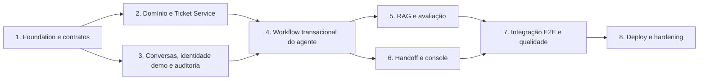

# Roadmap de implementação — Nexo Assist

Roadmap proposto e ordenado por dependências; não é requisito adicional ao [PRD](../PRD.md). Cada fase deve preservar as regras de confirmação, ownership e handoff antes de ampliar capacidade do modelo.

## Fase 1 — Foundation e contratos

**Entregas**

- Confirmar monorepo pnpm/Turborepo, pacotes/aplicações e TypeScript strict.
- Registrar decisões de autenticação demonstrativa, schemas PostgreSQL e ownership.
- Definir contratos Zod iniciais, envelope de erro, IDs e trace context.
- Docker Compose local com PostgreSQL/pgvector e health checks.
- Configuração `.env.example` sem valores secretos.

**Aceite:** `web`, `nexo-assist-agent` e `ticket-service` têm limites de execução e contratos claros; documentação não promete chamadas não especificadas no PRD.

## Fase 2 — Domínio e Ticket Service

**Entregas**

- Entidades/migrations de funcionário seed, ticket, histórico e idempotência.
- CRUD necessário, busca own-only, tipos/categorias/prioridades e cálculo de SLA.
- Detecção de duplicidade e regra de reabertura de até sete dias.
- Estados de falha/timeout e testes de contrato e integração PostgreSQL.

**Aceite:** isolamento por funcionário; duplicidade não cria ticket silenciosamente; falha ou retry não duplica escrita; histórico transacional.

## Fase 3 — Conversas, identidade demo e auditoria

**Entregas**

- Modelo persistente de conversas, mensagens, handoffs e execuções.
- Login apenas para empregados de exemplo, qualquer senha só no perfil demonstrativo, papéis separados.
- Limite de 30 mensagens do funcionário por conversa.
- Endpoints para histórico, ownership e auditoria mínima.

**Aceite:** reinício preserva estado; usuário não lê conversa de terceiros; limite é atômico; configuração insegura não inicia em modo produção.

## Fase 4 — Workflow transacional do agente

**Entregas**

- Agente único Mastra e tools com schemas.
- Workflows de consulta de ticket, draft, confirmação, criação/atualização/reabertura.
- Integração autenticada ao Ticket Service.
- SSE com eventos rastreáveis e tratamento explícito de erro.

**Aceite:** nenhuma escrita sem confirmação vinculada ao draft; confirmação antiga/editada não executa; resposta só declara sucesso após persistência.

## Fase 5 — RAG e avaliação

**Entregas**

- Ingestão controlada de artigos seed, versionamento, pgvector e busca lexical.
- Referências de fontes e filtros de plataforma/versão/status.
- Dataset de avaliação com casos de VPN Windows 10/11, horário, ausência de evidência e instrução maliciosa.

**Aceite:** nenhuma informação privada em índice; resposta cita evidência; falha de recuperação não é mascarada como “sem resultados”; limitações/abstenções testadas.

## Fase 6 — Handoff e console de analista

**Entregas**

- Fila com filtros/status, histórico, tickets do funcionário.
- Assumir com concorrência segura, devolver ao agente, encerrar.
- Agente pausado em `waiting_analyst` e `analyst_assigned`; resumo estruturado.
- Eventos de estado visíveis e auditáveis.

**Aceite:** agente não responde enquanto analista atende; só analista autorizado altera o estado; transições persistem e sobrevivem ao reinício.

## Fase 7 — UI, integração e QA

**Entregas**

- Fluxos de chat e console de acordo com protótipo do Anexo C.
- Loading, erro, retry, cards, seleção de tickets, confirmação explícita e retomada.
- Testes unitários, integração, contrato, autorização e E2E das jornadas críticas.
- Verificação do limite, SSE/reconexão e exibição da auditoria.

**Aceite:** completar consulta de conhecimento, consulta de ticket, ticket confirmado e handoff/retomada sem acesso cruzado; documentar evidência dos testes.

## Fase 8 — Deploy e hardening

**Entregas**

- Segredos em ambiente seguro, TLS, rate limit, monitoramento e retenção.
- Desabilitar login de senha arbitrária; configurar SSO real antes do uso por funcionários.
- Migrações e seeds reprodutíveis; limites de uso/custo OpenAI.
- README com comandos locais, decisões, trade-offs, qualidade e deploy opcional.

**Critério de bloqueio:** não publicar serviço acessível sem autenticação real e controles para custos/abuso. Deploy é diferencial do PRD, não dependência funcional do MVP local.

## Matriz mínima de testes

| Área         | Cenários indispensáveis                                                                     |
| ------------ | ------------------------------------------------------------------------------------------- |
| Domínio      | Classificação, dados obrigatórios, prioridade/SLA e prazo vencido                           |
| Ownership    | Funcionário A tenta ler/atualizar ticket e conversa de B                                    |
| Escritas     | Rascunho sem confirmação, confirmação explícita, draft alterado, retry idempotente          |
| Duplicidade  | Ticket aberto semelhante, ticket recente resolvido, nenhum candidato, candidatos ambíguos   |
| Resiliência  | Ticket Service timeout/indisponível e resposta incerta após timeout de escrita              |
| Handoff      | Pedido explícito, crítico, vencido, baixa evidência; pausa até assunção/devolução           |
| Analista     | Assunção concorrente, funcionário sem papel de analista, encerramento                       |
| RAG          | Fonte correta, incompatibilidade de plataforma, sem evidência, conteúdo de prompt injection |
| Persistência | Reinicialização de aplicação preserva conversa, status, tickets e auditoria                 |
| Limites      | 30 mensagens aceitas, 31ª recusada sem persistir                                            |

## Critérios de saída do MVP

1. Todas as jornadas do PRD aplicáveis ao protótipo são demonstráveis.
2. Nenhuma operação de ticket altera estado sem confirmação explícita e validação no servidor.
3. Isolamento por funcionário e papel de analista têm testes negativos.
4. Erros não viram sucesso aparente; retries de escrita são idempotentes.
5. Decisões, fontes, ferramentas, resultados e handoffs são legíveis.
6. Chat, tickets e estado de atendimento persistem após reinício.
7. RAG respeita restrições dos artigos e abstém-se sem evidência.

## Riscos e decisões que bloqueiam produção

- O PRD não define fornecedor OIDC, calendário de feriados/timezone, matriz detalhada de classificação nem política de retenção.
- Login com senha arbitrária é apenas para seed do protótipo e deve ser removido antes de exposição pública.
- A aplicação Mastra existente é starter genérico com ferramentas e provedores que não atendem o produto; verificar dependências e APIs antes de reutilizá-la.
- Metas de latência, custo e confiança precisam de medições/datasets; não há baseline no PRD.
