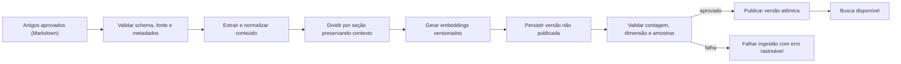
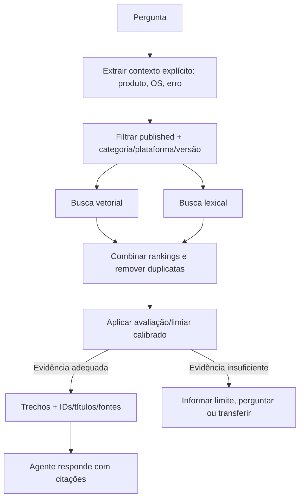

# Arquitetura RAG — Nexo Assist

**Referência funcional:** [PRD](../PRD.md) · **Agente:** [AI_AGENT_DESIGN](./AI_AGENT_DESIGN.md)

## 1. Escopo e limites

RAG responde dúvidas sobre conhecimento institucional de TI por artigos aprovados. Chamados privados são obtidos exclusivamente pelo Ticket Service, nunca pela recuperação vetorial. Não indexar mensagens, tickets, anexos privados ou dados identificáveis no corpus compartilhado.

## 2. Decisões iniciais

| Item        | Implementação atual                                                                                             |
| ----------- | --------------------------------------------------------------------------------------------------------------- |
| Vetor       | `@mastra/pg` `PgVector` sobre PostgreSQL/pgvector, no schema `mastra_storage`                                   |
| Embedding   | OpenAI `text-embedding-3-small`, dimensão validada em 1536                                                      |
| Banco       | Metadados e chunks em `KnowledgeDocument`/`KnowledgeChunk` Prisma no schema `public`; vetores em storage Mastra |
| Busca       | Busca vetorial + full-text PostgreSQL, fusão Reciprocal Rank Fusion e validação final contra domínio            |
| Chunking    | Mastra `MDocument`; Markdown preserva cabeçalhos, alvo de 1200 caracteres e overlap de 120 caracteres           |
| Recuperação | Top-K padrão 5; filtros por status, categoria, tags e plataforma                                                |
| Índice      | HNSW cosine, com índices btree sobre metadados                                                                  |
| Resposta    | Fonte, versão, plataforma e data do documento acompanham o chunk; resposta sem evidência deve abster-se         |

Parâmetros são hipóteses de partida e não critérios de verdade. O corpus seed do PRD contém poucos artigos; medir antes de adicionar complexidade ou índice aproximado. Versionar modelo e dimensão: trocar embedding exige reprocessar todos os chunks de forma consistente.

## 3. Metadados

Cada documento contém: `documentId`, título, categoria, tags, plataforma(s), versão, status (`draft | published | archived`), fonte, data de atualização e hash SHA-256 do texto normalizado. Chunk mantém `documentId`, ordinal, heading/contexto, conteúdo e contagem aproximada de tokens. O vector store guarda o embedding e os mesmos metadados de filtro, além do conteúdo do chunk.

Exemplos do PRD incluem erro 809 de VPN (restrito a Windows 10) e horário do Service Desk (plantão 24h para chamados críticos). A resposta deve respeitar as restrições do documento e não generalizar o procedimento para Windows 11.

## 4. Ingestão e publicação

- Ingestão é processo controlado, não tool pública do agente no MVP.
- O CLI só aceita `recordType: knowledge_article` e arquivos dentro de `knowledge-base/`; tickets e dados privados não têm rota de ingestão.
- `contentHash` e `(source, version)` tornam reingestão idempotente.
- O pipeline persiste vetores antes de substituir os chunks de domínio e só promove a versão após indexação; recuperar somente documento publicado validado no domínio.
- Erros de OpenAI, documento inválido ou embedding de dimensão inesperada são explícitos; preservar versão publicada anterior.
- Alterar artigo despublica/arquiva versão antiga conforme política e retém auditoria de versão.

## 5. Recuperação

Filtros de plataforma aplicam-se antes da resposta: com plataforma explícita, recupera documentos globais e os compatíveis com ela; sem plataforma, somente documentos globais. Versões arquivadas são excluídas do vector filter e revalidadas contra o status relacional. Não escolher automaticamente um procedimento incompatível quando plataformas divergem. Um limiar de relevância deve ser medido em conjunto de avaliação, não presumido como valor universal.

## 6. Resposta e citações

O contexto para o LLM contém somente os top chunks necessários, metadados não sensíveis e instrução para citar a origem. A UI deve apresentar título e referência do artigo, idealmente seção/trecho. A auditoria guarda os IDs/versões/chunks realmente usados. Texto recuperado é dado não confiável: não pode sobrescrever instruções, autorizar ferramentas nem solicitar divulgação de dados.

Se não houver fonte útil, a resposta explicita que a base não encontrou procedimento confiável. Não improvisar solução para preencher lacuna. Em solicitação urgente/crítica, seguir workflow de handoff.

## 7. Avaliação

O dataset versionado está em `apps/nexo-assist-agent/evals/rag-evaluation.json`, com fontes esperadas, fatos e resposta de referência. O runner calcula Recall@K e MRR e usa avaliação de modelo para groundedness, relevância e cobertura. Incluir:

- “Como corrigir erro 809 da VPN?” → artigo VPN e passo aplicável à plataforma informada.
- “Uso Windows 11; posso reinstalar o cliente?” → não aplicar instrução limitada a Windows 10; dizer que o artigo orienta abrir chamado.
- “Qual o horário do Service Desk?” → horário e regra de plantão conforme artigo.
- “Como solicitar segundo monitor?” → procedimento aprovado de Hardware, se disponível.
- Consulta de problema sem artigo → abstenção e opção de ticket/analista.
- Pergunta com versão/plataforma contraditória → clarificação.
- Prompt injection embutido em artigo ou pergunta → não muda regras/políticas.

Métricas por versão de corpus/modelo incluem Recall@K, MRR, groundedness, relevância, cobertura, correção de restrições e taxa de abstenção correta. Critérios de aprovação e thresholds são definidos após baseline rotulado; não inventar um número nesta etapa.

## 8. Privacidade e operação

- Indexação apenas de artigos institucionais aprovados; não incluir chamados do Anexo B sem sanitização e finalidade explícita.
- Credenciais de OpenAI e banco ficam fora do código; controlar orçamento e rate limit.
- Logs guardam IDs, métricas e referências, minimizando cópia de conteúdo pessoal.
- Falha de embeddings afeta ingestão; falha de banco/recuperação não deve ser simulada como resultado vazio.
- Migração de provedor/modelo mantém versões do embedding identificáveis e reindexação reproduzível.

## 9. Referências técnicas

- [Mastra — armazenamento PostgreSQL](https://mastra.ai/docs/memory/storage)
- [pgvector — README e índices](https://github.com/pgvector/pgvector)
- [Prisma — extensões ORM](https://www.prisma.io/docs/orm/extensions)

Compatibilidade de `vector(1536)`, operadores, migrations e abstração Prisma varia por versão. Confirmar com dependências fixadas; SQL específico deve permanecer tipado/parametrizado no repositório RAG.
