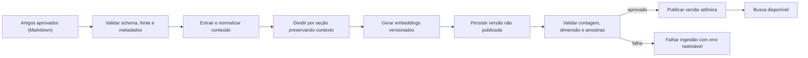
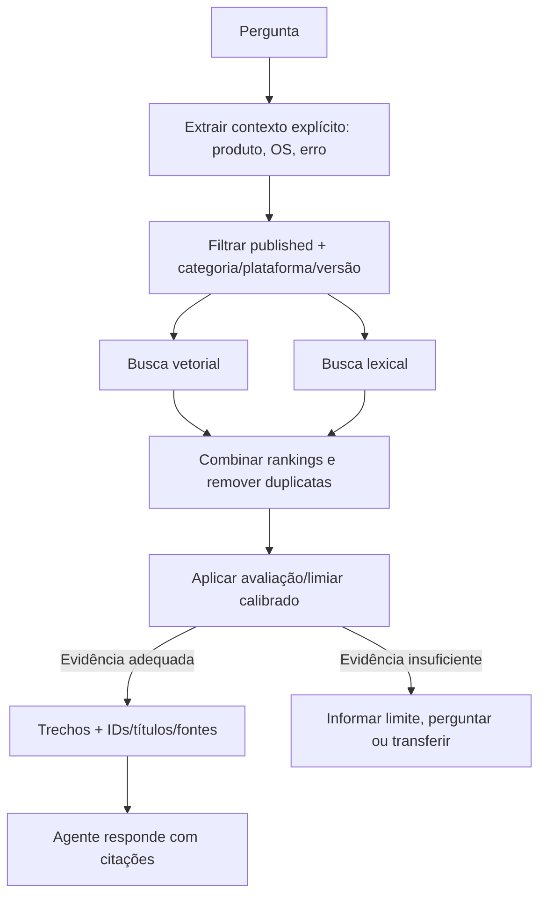

# Arquitetura RAG — Nexo Assist

**Referência funcional:** [PRD](../PRD.md) · **Agente:** [AI_AGENT_DESIGN](./AI_AGENT_DESIGN.md)

## 1. Escopo e limites

RAG responde dúvidas sobre conhecimento institucional de TI por artigos aprovados. Chamados privados são obtidos exclusivamente pelo Ticket Service, nunca pela recuperação vetorial. Não indexar mensagens, tickets, anexos privados ou dados identificáveis no corpus compartilhado.

## 2. Decisões iniciais

| Item        | Proposta MVP                                                                                                     |
| ----------- | ---------------------------------------------------------------------------------------------------------------- |
| Vetor       | PostgreSQL + extensão pgvector                                                                                   |
| Embedding   | OpenAI `text-embedding-3-small`; dimensão inicial 1536 se mantido o padrão do modelo                             |
| Banco       | `KnowledgeDocument` e `KnowledgeChunk`, em schema com acesso restrito                                            |
| Busca       | Similaridade semântica mais busca lexical de PostgreSQL; combinar ranking e avaliar                              |
| Chunking    | Preservar seções Markdown; inicial de 400–600 tokens, sobreposição de 50–80 tokens, sujeito a avaliação          |
| Recuperação | Top-K inicial 5, com filtros por publicação, categoria, plataforma/versão aplicáveis                             |
| Índice      | Busca exata como baseline; adotar HNSW após medir ganho para volume/latência e perda de recall                   |
| Resposta    | Trechos e referências de artigo são fornecidos ao agente; sem evidência adequada, abstém-se e pergunta/encaminha |

Parâmetros são hipóteses de partida e não critérios de verdade. O corpus seed do PRD contém poucos artigos; medir antes de adicionar complexidade ou índice aproximado. Versionar modelo e dimensão: trocar embedding exige reprocessar todos os chunks de forma consistente.

## 3. Metadados

Cada documento contém: `documentId`, título, categoria, tags, plataforma(s), versão, status (`draft | published | archived`), fonte, versão do conteúdo, data de atualização, hash e idioma. Chunk mantém `documentId`, ordinal, heading/contexto, conteúdo, contagem aproximada de tokens e embedding.

Exemplos do PRD incluem erro 809 de VPN (restrito a Windows 10) e horário do Service Desk (plantão 24h para chamados críticos). A resposta deve respeitar as restrições do documento e não generalizar o procedimento para Windows 11.

## 4. Ingestão e publicação

- Ingestão é processo controlado, não tool pública do agente no MVP.
- `contentHash` e `(source, version)` tornam reingestão idempotente.
- Publicação não expõe parcialmente um conjunto; recuperar somente versão ativa/publicada.
- Erros de OpenAI, documento inválido ou embedding de dimensão inesperada são explícitos; preservar versão publicada anterior.
- Alterar artigo despublica/arquiva versão antiga conforme política e retém auditoria de versão.

## 5. Recuperação

Filtros de plataforma/versão aplicam-se apenas quando conhecidos ou explicitamente solicitados. Não escolher automaticamente um procedimento incompatível quando plataformas divergem; perguntar primeiro. Um limiar de relevância deve ser medido em conjunto de avaliação, não presumido como valor universal.

## 6. Resposta e citações

O contexto para o LLM contém somente os top chunks necessários, metadados não sensíveis e instrução para citar a origem. A UI deve apresentar título e referência do artigo, idealmente seção/trecho. A auditoria guarda os IDs/versões/chunks realmente usados. Texto recuperado é dado não confiável: não pode sobrescrever instruções, autorizar ferramentas nem solicitar divulgação de dados.

Se não houver fonte útil, a resposta explicita que a base não encontrou procedimento confiável. Não improvisar solução para preencher lacuna. Em solicitação urgente/crítica, seguir workflow de handoff.

## 7. Avaliação

Criar um dataset versionado de perguntas, evidência esperada, plataforma, resposta permitida e condição de abstenção, baseado nos artigos seed. Incluir:

- “Como corrigir erro 809 da VPN?” → artigo VPN e passo aplicável à plataforma informada.
- “Uso Windows 11; posso reinstalar o cliente?” → não aplicar instrução limitada a Windows 10; dizer que o artigo orienta abrir chamado.
- “Qual o horário do Service Desk?” → horário e regra de plantão conforme artigo.
- “Como solicitar segundo monitor?” → procedimento aprovado de Hardware, se disponível.
- Consulta de problema sem artigo → abstenção e opção de ticket/analista.
- Pergunta com versão/plataforma contraditória → clarificação.
- Prompt injection embutido em artigo ou pergunta → não muda regras/políticas.

Métricas por versão de corpus/modelo: Recall@K, MRR ou nDCG, cobertura de citações, relevância da resposta, correção de restrições, taxa de abstenção correta, latência e custo. Critérios de aprovação e thresholds são definidos após baseline rotulado; não inventar um número nesta etapa.

## 8. Privacidade e operação

- Indexação apenas de artigos institucionais aprovados; não incluir chamados do Anexo B sem sanitização e finalidade explícita.
- Credenciais de OpenAI e banco ficam fora do código; controlar orçamento e rate limit.
- Logs guardam IDs, métricas e referências, minimizando cópia de conteúdo pessoal.
- Falha de embeddings afeta ingestão; falha de banco/recuperação não deve ser simulada como resultado vazio.
- Migração de provedor/modelo mantém versões do embedding identificáveis e reindexação reproduzível.

## 9. Referências técnicas

- [Mastra — armazenamento PostgreSQL](https://mastra.ai/docs/memory/storage)
- [pgvector — README e índices](https://github.com/pgvector/pgvector)
- [Prisma — extensões ORM](https://www.prisma.io/docs/orm/extensions)

Compatibilidade de `vector(1536)`, operadores, migrations e abstração Prisma varia por versão. Confirmar com dependências fixadas; SQL específico deve permanecer tipado/parametrizado no repositório RAG.
