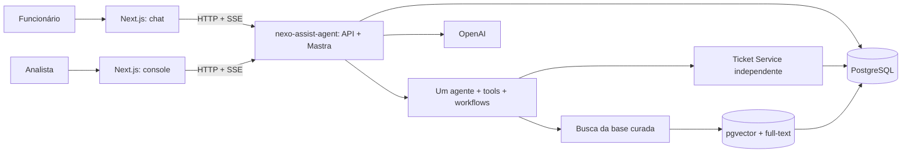

# Software Design Document — Nexo Assist

**Projeto Mastra:** `nexo-assist-agent`  
**Status:** proposta para o MVP  
**Fonte funcional primária:** [PRD](../PRD.md)

## 1. Propósito e escopo

Este documento consolida as decisões técnicas propostas para o Nexo Assist: atendimento conversacional de Service Desk para funcionários, com consulta à base de conhecimento, consulta e manutenção de chamados, transferência para analistas e auditoria das ações.

O documento é de arquitetura; não implementa código. Os detalhes funcionais vêm do PRD. Quando uma regra não está definida no PRD, ela aparece como decisão proposta ou questão aberta, e não como requisito original.

### Dentro do MVP

- Login demonstrativo para funcionários de exemplo e identificação de analistas.
- Chat do funcionário com respostas em streaming, cards, seleção de chamados e confirmação de rascunhos.
- Limite de 30 mensagens por conversa.
- Serviço simulado de chamados, separado do backend Mastra.
- RAG sobre artigos de TI curados, sem indexar chamados privados.
- Console de analista para fila, histórico, assunção, devolução e encerramento.
- Persistência de conversas, chamados e estado de atendimento após reinício.
- Registro legível de intenção, fontes, ações, resultado e motivo operacional.

### Fora do MVP

- Integração com diretório corporativo ou sistema real de tickets.
- Autenticação de produção, SSO e provisionamento corporativo.
- Ingestão irrestrita de formatos de documentos e conteúdo externo.
- Decisões de negócio tomadas apenas pelo modelo.
- Arquitetura multiagente, salvo evidência futura de necessidade.

## 2. Requisitos do produto e decisões

| ID   | Requisito do PRD                                                                      | Decisão de arquitetura                                                                                                                              |
| ---- | ------------------------------------------------------------------------------------- | --------------------------------------------------------------------------------------------------------------------------------------------------- |
| R-01 | Funcionário conversa em português e recebe respostas em tempo real.                   | Next.js consome o backend de IA por HTTP e streaming SSE.                                                                                           |
| R-02 | Consultar chamados próprios sem lembrar o número e identificar atraso.                | Ticket Service filtra obrigatoriamente pela identidade autenticada e calcula o SLA.                                                                 |
| R-03 | Complementar chamado existente.                                                       | Atualização passa por rascunho e confirmação explícita, como qualquer escrita.                                                                      |
| R-04 | Abrir chamado com dados completos e confirmar antes da criação.                       | Workflow determinístico valida, verifica duplicidade, mostra rascunho e somente então chama o Ticket Service.                                       |
| R-05 | Solicitar analista ou ser transferido em caso crítico, vencido ou de baixa segurança. | Handoff persistido pausa o agente até transição explícita feita pelo analista.                                                                      |
| R-06 | Retomar conversa em outro dia.                                                        | Mensagens e estado são persistidos; a memória é recuperada apenas para o proprietário e conversa correspondentes.                                   |
| R-07 | Analista vê fila e histórico, assume, devolve ou encerra.                             | API de atendimento exige papel de analista e realiza assunção com controle de concorrência.                                                         |
| R-08 | Transparência sobre o que o agente fez e por quê.                                     | Cada execução registra intenção, ações, fontes, resultados, confiança operacional e justificativa curta; não se expõe raciocínio privado do modelo. |
| R-09 | Chamados são privados ao funcionário que os abriu.                                    | Ownership é verificado no servidor e no Ticket Service; identificadores enviados pelo cliente não concedem acesso.                                  |
| R-10 | Sistema de chamados pode ficar indisponível por alguns segundos.                      | Timeout, retry limitado apenas para falha transitória e idempotência para escrita; erros ficam visíveis ao usuário.                                 |
| R-11 | No protótipo, e-mails de funcionários de exemplo aceitam qualquer senha.              | Exceção estritamente demonstrativa; não é mecanismo de autenticação para produção.                                                                  |
| R-12 | Limite de 30 mensagens por sessão.                                                    | A sessão é uma conversa persistida. Ao atingir o limite, o sistema informa o limite e permite iniciar outra conversa.                               |

## 3. Atores e limites de confiança

- **Funcionário:** usa apenas suas conversas e chamados.
- **Analista:** usa o console e as ações autorizadas de atendimento.
- **Frontend:** não é autoridade para identidade, ownership, papel, prioridade ou confirmação.
- **AI Backend:** interpreta mensagens, coordena workflows e conserva conversas/auditoria.
- **Ticket Service:** autoridade para dados e regras de chamados.
- **LLM e provedor de embeddings:** processadores externos de conteúdo enviado para inferência; não são fonte de verdade nem autoridade de autorização.
- **PostgreSQL:** persistência transacional e vetorial; no protótipo, dados Prisma ficam no schema `public` e o storage interno do Mastra em `mastra_storage`, com papel de runtime de privilégio mínimo e RLS.

## 4. Visão de arquitetura

Separação física no bootstrap e ownership lógico dos serviços:

- Schema `public`: tabelas de domínio administradas pelo Prisma neste protótipo; APIs continuam responsáveis pelos dados que possuem.
- Schema `mastra_storage`: tabelas internas administradas pelo `PostgresStore`, sem compartilhar tabelas de domínio.

RLS e FKs compostas isolam dados por funcionário nas tabelas privadas. Separar schemas de domínio por serviço ou bancos físicos continua sendo uma opção de evolução, não uma exigência funcional do PRD.

## 5. Regras de negócio que não pertencem ao LLM

As regras de tipo, categorias, dados obrigatórios, ownership, duplicidade, reabertura em até sete dias, cálculo de SLA, limite da conversa, estados do handoff e confirmação de escrita são verificadas em código determinístico no domínio/serviços.

O modelo pode propor intenção, extração de campos, classificação inicial e resumo. A aplicação valida esses valores, pergunta quando faltam dados ou há ambiguidade e nunca interpreta uma chamada de ferramenta ou resposta do modelo como autorização por si só.

## 6. Requisitos não funcionais

- **Privacidade:** isolamento por funcionário aplicado em todas as consultas e mutações; dados de chamados não entram em prompts de outros usuários.
- **Consistência:** escrita idempotente; transação local por serviço; histórico de mudança na mesma operação de domínio.
- **Resiliência:** erros de dependências são explícitos; nenhuma escrita é repetida sem idempotência.
- **Auditabilidade:** correlação por `traceId` e `executionId`, com eventos e resultados suficientes para explicar a resposta.
- **Evolução:** contratos Zod versionados; integrações encapsuladas; sem dependência de Mastra no Ticket Service.
- **Desempenho:** metas numéricas serão estabelecidas a partir de medições do protótipo; nenhuma meta de latência foi definida pelo PRD.

## 7. Decisões propostas e questões em aberto

| Tema                        | Proposta para o MVP                                                                                             | Pendência antes de produção                                                                               |
| --------------------------- | --------------------------------------------------------------------------------------------------------------- | --------------------------------------------------------------------------------------------------------- |
| Identidade                  | Login de demonstração para funcionários seed; papel analista separado.                                          | Definir provedor OIDC/SSO, sessão, MFA e ciclo de vida de contas.                                         |
| Calendário de SLA           | Usar o calendário local da Nexo; prioridade crítica conta continuamente e demais prazos úteis.                  | Definir timezone, feriados, dias úteis, pausas e semântica exata de primeira resposta versus atualização. |
| Classificação de prioridade | Usar impacto e urgência descritos no PRD; solicitar informação faltante.                                        | Definir matriz formal e tratamento de conflito entre impacto e urgência.                                  |
| Duplicidade                 | Considerar apenas chamados do funcionário; regras por status/categoria e similaridade são validadas no domínio. | Definir limiar e UX quando houver mais de um candidato plausível.                                         |
| Confiança                   | Baixa evidência ou ambiguidade leva a pergunta ou handoff, nunca a escrita automática.                          | Calibrar thresholds com dataset e definir valores de corte.                                               |
| Busca vetorial              | Busca semântica e lexical; busca exata inicialmente, índice aproximado apenas após medição.                     | Reavaliar indexação e dimensões quando corpus e carga forem conhecidos.                                   |
| Mensagens                   | 30 mensagens de funcionário por conversa; mensagens de resposta e eventos do sistema não reduzem o limite.      | Confirmar definição de “mensagem por sessão” com produto.                                                 |

## 8. Critérios de aceite arquiteturais

1. Funcionário A não consegue obter ou alterar conversa/chamado do funcionário B nem usando IDs conhecidos.
2. Criação e atualização não ocorrem antes de confirmação explícita vinculada ao rascunho exibido.
3. Handoff persistido bloqueia novas respostas automáticas até retomada pelo analista.
4. Falha do Ticket Service aparece como estado de erro recuperável; não é reportada como sucesso.
5. Execução mostra intenção, fontes consultadas, ferramentas, resultado e justificativa operacional.
6. Dados e status sobrevivem a reinício de todos os serviços.
7. Uma resposta RAG referencia artigo e trecho recuperados; sem evidência adequada, o agente informa a limitação.

## 9. Consistência entre documentos

- [Arquitetura](./ARCHITECTURE.md) define componentes e limites de serviço.
- [Modelo de dados](./DATA_MODEL.md) é a referência de entidades, relações e estados.
- [Desenho do agente](./AI_AGENT_DESIGN.md) define decisões, tools e workflows.
- [RAG](./RAG_DESIGN.md) trata apenas de conhecimento institucional.
- [Contratos de API](./API_CONTRACTS.md) descreve comunicação e payloads.
- [Roadmap](./IMPLEMENTATION_ROADMAP.md) ordena entregas e testes.

Em caso de divergência, o PRD prevalece para comportamento do produto; este SDD documenta decisões técnicas propostas.
