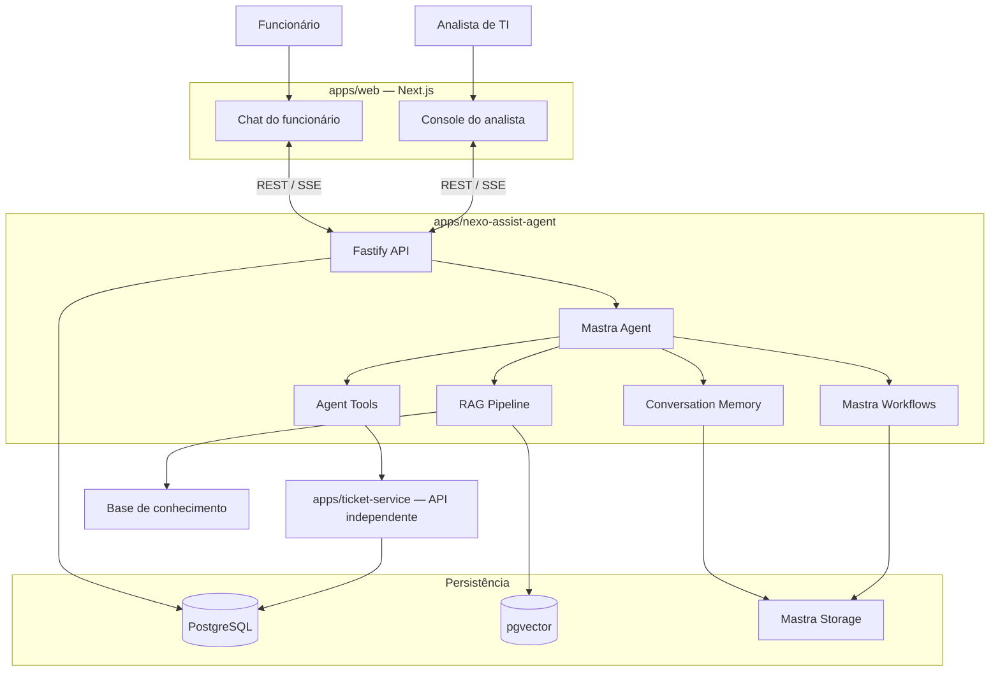
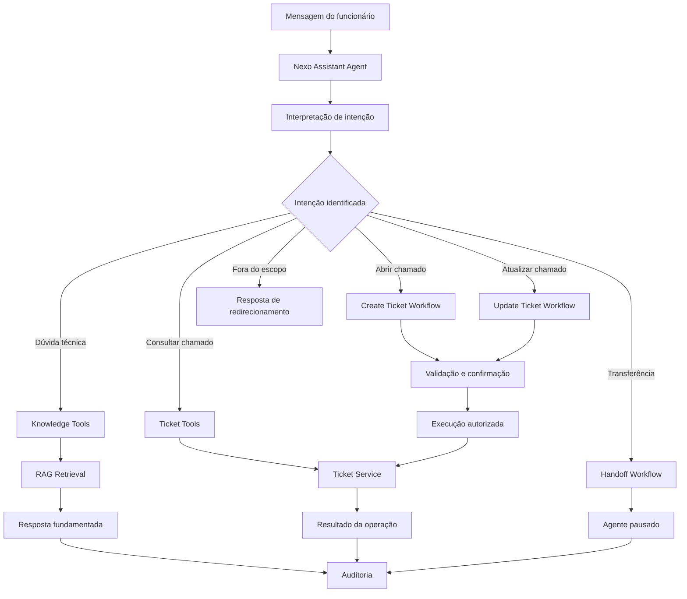
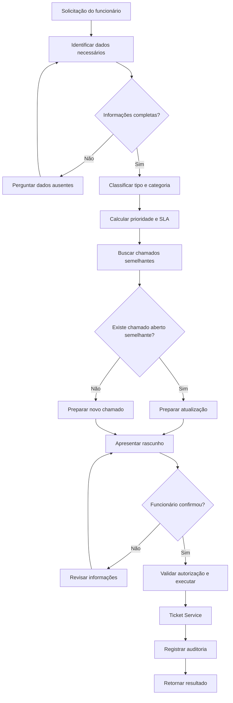
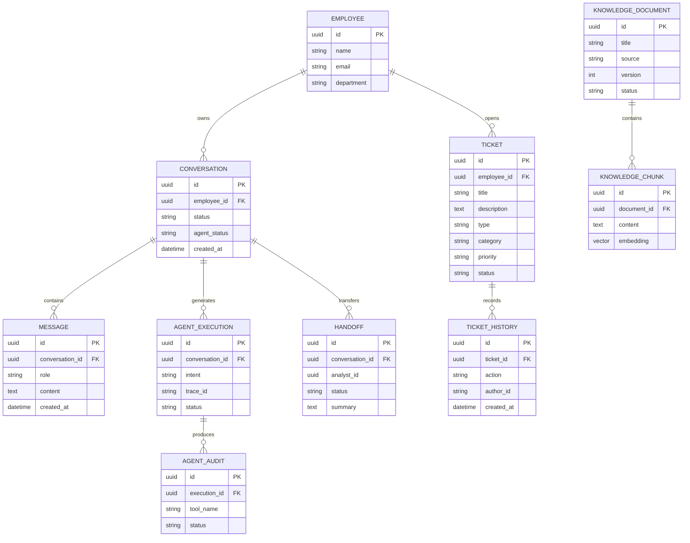
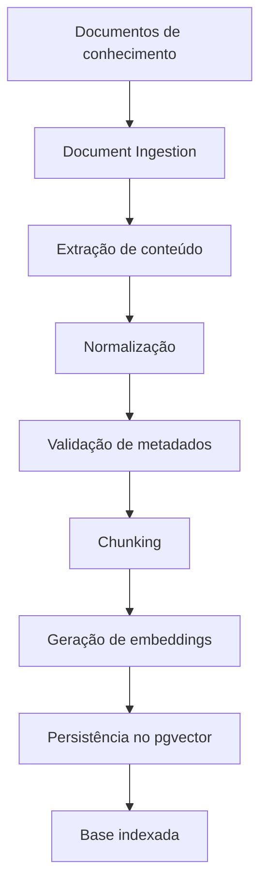
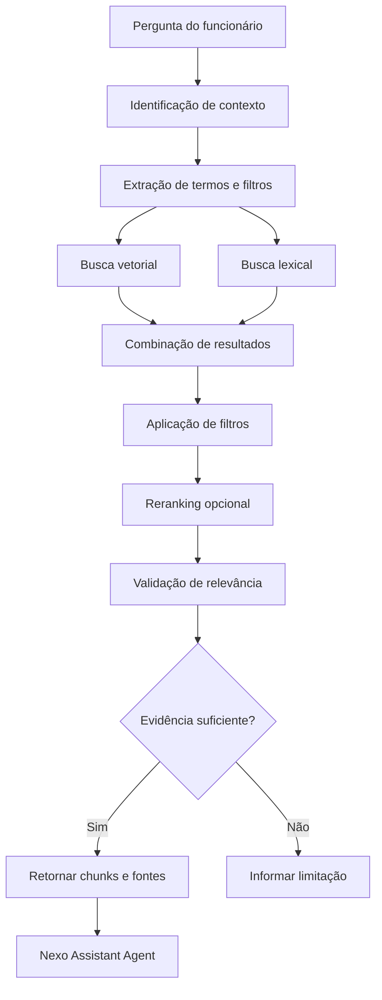
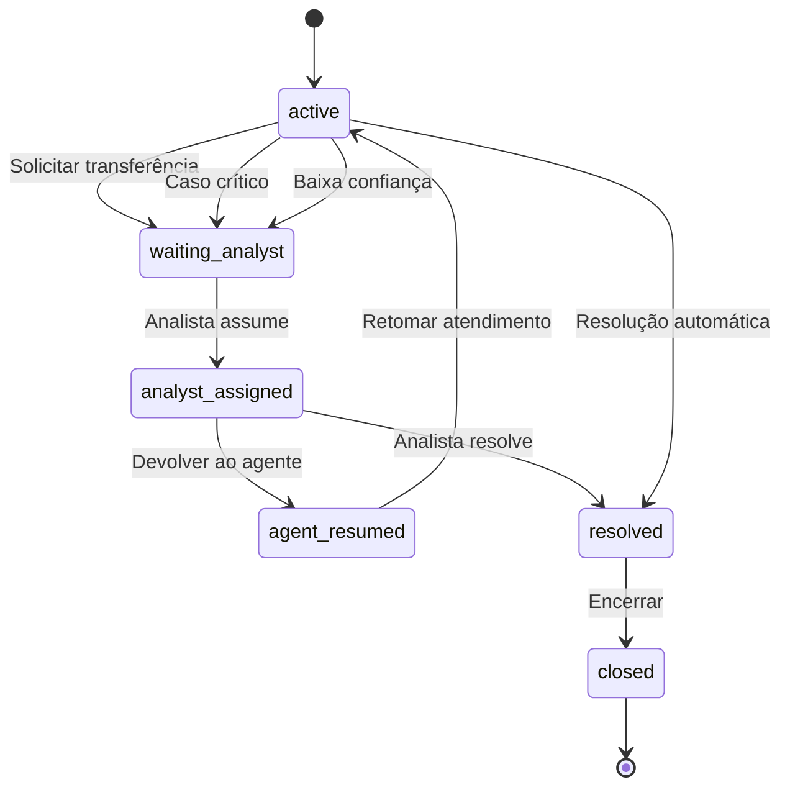
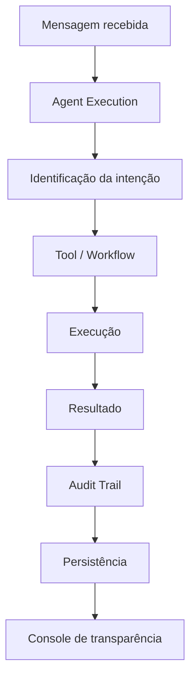
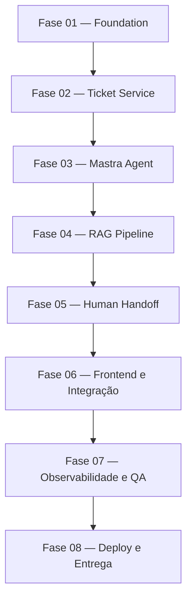
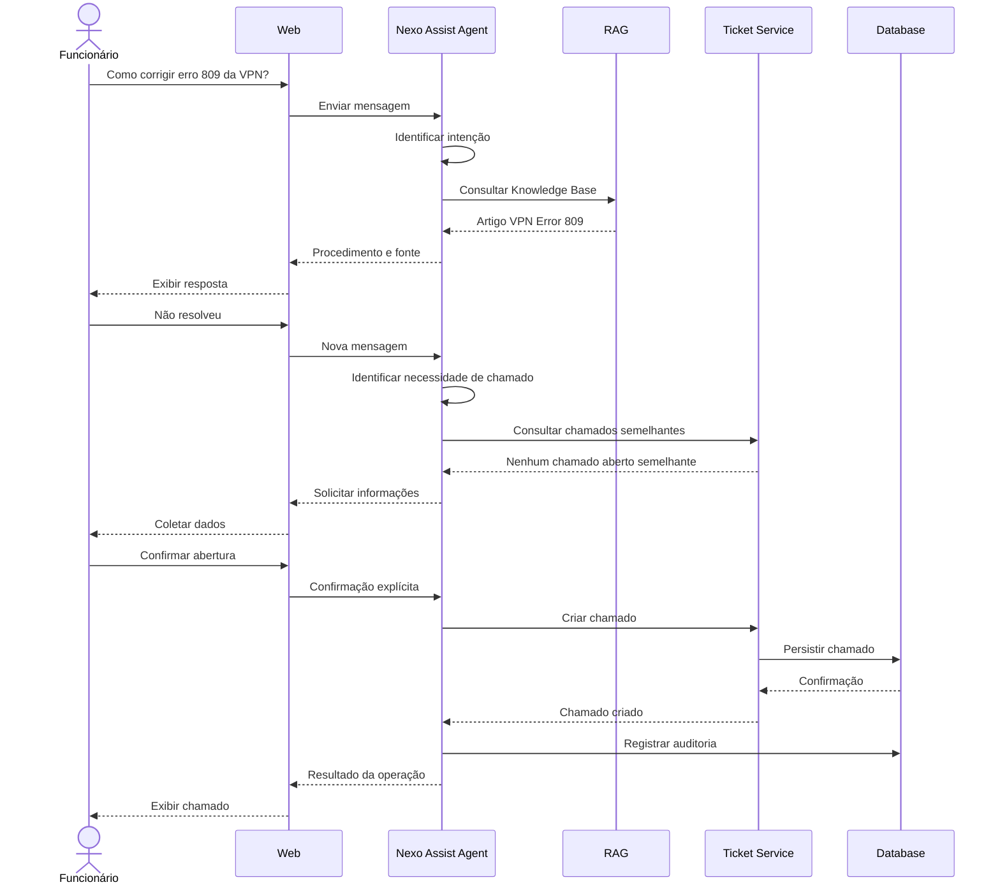

# Nexo Assist — SDD, Arquitetura e Prompts de Desenvolvimento

**Projeto:** Nexo Assist  
**Projeto Mastra:** `nexo-assist-agent`  
**Documento:** Software Design Document (SDD)  
**Versão:** 2.0  
**Data:** 31/10/2026  
**Stack principal:** TypeScript · Mastra · PostgreSQL · pgvector · Prisma · Fastify · Next.js

---

# 1. Visão geral do projeto

## 1.1. Contexto

O Nexo Assist é um agente inteligente de Service Desk de TI que permite aos funcionários interagir com o suporte técnico por meio de uma interface conversacional.

O sistema deverá interpretar solicitações em linguagem natural, consultar uma base de conhecimento, identificar chamados existentes, abrir ou atualizar solicitações e encaminhar atendimentos para analistas humanos quando necessário.

O projeto utilizará o ecossistema **Mastra** para orquestração de agentes, ferramentas, workflows, memória e recursos de RAG.

O serviço de chamados será implementado separadamente do agente, simulando a integração com um sistema legado de Service Desk.

## 1.2. Objetivos

- Resolver dúvidas técnicas sem necessidade de abertura de chamados.
- Consultar chamados vinculados ao funcionário autenticado.
- Abrir chamados com classificação adequada.
- Atualizar solicitações existentes, evitando duplicidades.
- Identificar prioridade e calcular SLA.
- Encaminhar situações críticas ou complexas para analistas.
- Preservar o contexto das conversas.
- Registrar e apresentar as decisões e ações executadas pelo agente.

## 1.3. Indicadores de sucesso

| Indicador | Objetivo |
|---|---|
| Resolução sem fila | Resolver dúvidas no próprio chat |
| Qualidade dos chamados | Chamados completos e corretamente classificados |
| Redução de duplicidade | Atualizar chamados existentes |
| Encaminhamento | Transferir casos com contexto suficiente |
| Transparência | Rastrear decisões e ferramentas |
| Persistência | Preservar conversas e estados após reinicializações |

# 2. Arquitetura tecnológica

## 2.1. Stack definida

| Camada | Tecnologia | Responsabilidade |
|---|---|---|
| Frontend | Next.js + React | Interface do funcionário e analista |
| Linguagem | TypeScript Strict | Tipagem de ponta a ponta |
| UI | Tailwind CSS + shadcn/ui | Componentes e design system |
| Agent Framework | Mastra | Agentes e workflows |
| Projeto Mastra | `nexo-assist-agent` | Aplicação de inteligência artificial |
| API | Fastify | Endpoints HTTP dos serviços |
| Validação | Zod | Contratos e validação |
| ORM | Prisma | Persistência de domínio |
| Database | PostgreSQL | Dados transacionais |
| Vector Database | pgvector | Embeddings e recuperação vetorial |
| LLM | OpenAI | Interpretação e geração de respostas |
| Embeddings | text-embedding-3-small | Representação vetorial |
| Testes | Vitest | Testes unitários e integração |
| Infraestrutura | Docker Compose | Ambiente local |
| Monorepo | pnpm + Turborepo | Organização dos projetos |

**Diretriz:** utilizar versões estáveis e APIs compatíveis, consultando a documentação oficial do Mastra antes da implementação. A configuração efetiva de storage, memória e workflows deverá seguir as APIs da versão instalada.

## 2.2. Arquitetura geral

O sistema será dividido em três aplicações independentes:

1. `web`: interface de atendimento.
2. `nexo-assist-agent`: backend de inteligência artificial.
3. `ticket-service`: serviço independente de chamados.



## 2.3. Responsabilidades dos serviços

### Frontend — `apps/web`

Responsável por:

- Login e autenticação.
- Chat conversacional.
- Exibição de respostas em tempo real.
- Cards de chamados.
- Confirmação de abertura e atualização.
- Histórico de conversas.
- Console de atendimento.
- Transferência e retomada de conversas.
- Visualização de auditoria do agente.

### AI Backend — `apps/nexo-assist-agent`

Responsável por:

- Inicialização do Mastra.
- Agente principal.
- Ferramentas do agente.
- Workflows determinísticos.
- RAG e recuperação de conhecimento.
- Memória de conversação.
- Integração com Ticket Service.
- Auditoria e observabilidade.
- Controle de execução e handoff.

### Ticket Service — `apps/ticket-service`

Responsável por:

- Cadastro e consulta de funcionários de exemplo.
- CRUD de chamados.
- Regras de negócio.
- Classificação de chamados.
- Verificação de duplicidade.
- Reabertura.
- Cálculo de SLA.
- Histórico de alterações.

O Ticket Service não deverá depender do Mastra.

# 3. Estrutura do monorepo

```text
nexo-assist/
│
├── apps/
│   │
│   ├── web/
│   │   ├── src/
│   │   │   ├── app/
│   │   │   ├── components/
│   │   │   ├── features/
│   │   │   │   ├── auth/
│   │   │   │   ├── chat/
│   │   │   │   ├── tickets/
│   │   │   │   └── analyst-console/
│   │   │   └── lib/
│   │   └── package.json
│   │
│   ├── nexo-assist-agent/
│   │   ├── src/
│   │   │   ├── mastra/
│   │   │   │   ├── index.ts
│   │   │   │   ├── agents/
│   │   │   │   │   └── nexo-assistant.agent.ts
│   │   │   │   ├── tools/
│   │   │   │   │   ├── knowledge/
│   │   │   │   │   ├── tickets/
│   │   │   │   │   ├── conversations/
│   │   │   │   │   └── handoff/
│   │   │   │   ├── workflows/
│   │   │   │   │   ├── resolve-knowledge.workflow.ts
│   │   │   │   │   ├── create-ticket.workflow.ts
│   │   │   │   │   ├── update-ticket.workflow.ts
│   │   │   │   │   ├── consult-ticket.workflow.ts
│   │   │   │   │   └── handoff.workflow.ts
│   │   │   │   ├── rag/
│   │   │   │   │   ├── ingestion/
│   │   │   │   │   ├── retrieval/
│   │   │   │   │   ├── embeddings/
│   │   │   │   │   └── evaluation/
│   │   │   │   └── memory/
│   │   │   ├── modules/
│   │   │   │   ├── conversations/
│   │   │   │   ├── knowledge-base/
│   │   │   │   ├── handoff/
│   │   │   │   └── audit/
│   │   │   ├── infrastructure/
│   │   │   ├── http/
│   │   │   └── index.ts
│   │   └── package.json
│   │
│   └── ticket-service/
│       ├── src/
│       │   ├── modules/
│       │   │   ├── employees/
│       │   │   ├── tickets/
│       │   │   └── sla/
│       │   ├── infrastructure/
│       │   ├── http/
│       │   └── index.ts
│       └── package.json
│
├── packages/
│   ├── contracts/
│   ├── database/
│   ├── domain/
│   ├── config/
│   └── shared/
│
├── docs/
│   ├── SDD.md
│   ├── ARCHITECTURE.md
│   ├── DATA_MODEL.md
│   ├── AI_AGENT_DESIGN.md
│   ├── RAG_DESIGN.md
│   ├── API_CONTRACTS.md
│   └── IMPLEMENTATION_ROADMAP.md
│
├── knowledge-base/
│   ├── access/
│   ├── network/
│   ├── hardware/
│   ├── software/
│   └── policies/
│
├── docker-compose.yml
├── pnpm-workspace.yaml
├── turbo.json
├── package.json
└── README.md
```

**Convenção de nomenclatura:** a aplicação Mastra será identificada como `nexo-assist-agent`, inclusive no `package.json` correspondente e na documentação. O monorepo continuará sendo `nexo-assist`.

# 4. Arquitetura do agente Mastra

## 4.1. Estratégia de agentes

A arquitetura inicial utilizará:

**1 agente principal + ferramentas especializadas + workflows determinísticos.**

Não será adotada uma arquitetura multiagente no MVP, pois as operações possuem regras bem definidas e precisam de previsibilidade.



## 4.2. Intenções reconhecidas

```typescript
type AgentIntent =
  | "KNOWLEDGE_QUERY"
  | "TICKET_CREATE"
  | "TICKET_UPDATE"
  | "TICKET_STATUS"
  | "TICKET_REOPEN"
  | "HUMAN_HANDOFF"
  | "OUT_OF_SCOPE";
```

A intenção deverá ser validada por schema Zod.

O agente poderá interpretar a intenção e propor parâmetros, mas as regras de autorização e execução deverão permanecer no backend.

## 4.3. Tools do agente

### Knowledge Tools

```text
searchKnowledgeBase
getKnowledgeArticle
```

### Ticket Tools

```text
listMyTickets
getMyTicket
findSimilarTickets
createTicketDraft
confirmCreateTicket
updateTicket
reopenTicket
```

### Conversation Tools

```text
getConversationContext
saveConversationState
getConversationStatus
```

### Handoff Tools

```text
requestAnalyst
generateHandoffSummary
resumeAgent
closeConversation
```

### System Tools

```text
calculateSla
validateTicketData
getCurrentEmployee
```

As ferramentas deverão ser pequenas, especializadas e possuir schemas explícitos.

## 4.4. Workflows

| Workflow | Responsabilidade |
|---|---|
| `resolve-knowledge` | Resolver dúvidas com RAG |
| `create-ticket` | Coletar dados e abrir chamado |
| `update-ticket` | Atualizar chamado existente |
| `consult-ticket` | Consultar status e SLA |
| `check-duplicates` | Detectar chamados semelhantes |
| `reopen-ticket` | Reabrir chamados elegíveis |
| `handoff-to-analyst` | Transferir atendimento |
| `resume-agent` | Retomar atendimento |

### Workflow de criação de chamado



**Regra obrigatória:** o agente não poderá criar ou atualizar um chamado antes da confirmação explícita do funcionário.

# 5. Regras de negócio

As regras do Service Desk serão implementadas na camada de domínio e validadas nos workflows.

## 5.1. Tipos

| Código | Tipo | Descrição |
|---|---|---|
| INC | Incidente | Algo parou ou não funciona |
| REQ | Requisição | Pedido de acesso, equipamento ou software |

## 5.2. Categorias

- Acesso
- Rede e VPN
- Hardware
- Software
- E-mail
- Outros

## 5.3. Prioridades e SLA

| Prioridade | Critério | Prazo |
|---|---|---|
| Crítica | Algo parado para equipe ou empresa | 1 hora |
| Alta | Impede uma pessoa de trabalhar ou compromisso no mesmo dia | 4 horas úteis |
| Média | Existe alternativa | 3 dias úteis |
| Baixa | Pedido ou melhoria sem urgência | 5 dias úteis |

## 5.4. Regras obrigatórias

1. Todo chamado precisa de título, descrição, tipo, categoria, prioridade e identificação de quem é afetado.
2. O agente deve apresentar o rascunho antes da criação.
3. Chamados abertos semelhantes devem ser atualizados, não duplicados.
4. Chamados resolvidos há até sete dias podem ser reabertos.
5. Transferências devem incluir resumo do atendimento.
6. O agente deverá permanecer pausado enquanto o analista atender.
7. Somente o proprietário poderá consultar informações de seus chamados.
8. Assuntos de RH, financeiro e facilities devem ser redirecionados.

# 6. Modelagem de dados

## 6.1. Entidades

| Entidade | Responsabilidade |
|---|---|
| Employee | Funcionários |
| Conversation | Conversas |
| Message | Mensagens |
| Ticket | Chamados |
| TicketHistory | Histórico de alterações |
| KnowledgeDocument | Documentos indexados |
| KnowledgeChunk | Fragmentos vetorizados |
| AgentExecution | Execuções do agente |
| AgentAudit | Auditoria das ferramentas |
| Handoff | Transferências |

## 6.2. Diagrama de entidades



## 6.3. Estados da conversa

```typescript
type ConversationStatus =
  | "active"
  | "waiting_analyst"
  | "analyst_assigned"
  | "resolved"
  | "closed";

type AgentStatus =
  | "active"
  | "paused"
  | "completed";
```

Os estados da conversa e do agente devem ser independentes.

Isso permite que uma conversa esteja aguardando analista enquanto o agente permanece pausado.

# 7. Estratégia de RAG — Knowledge Base

## 7.1. Objetivo

O RAG será responsável por fornecer conhecimento técnico confiável ao agente, permitindo consultar procedimentos, instruções, políticas e documentação institucional.

A base de conhecimento não deverá armazenar dados privados dos chamados ou informações pessoais dos funcionários.

A consulta a chamados será feita exclusivamente pelas ferramentas do Ticket Service.

## 7.2. Stack RAG

| Componente | Tecnologia |
|---|---|
| Framework | Mastra RAG |
| Embeddings | OpenAI text-embedding-3-small |
| Vector Store | pgvector |
| Database | PostgreSQL |
| Chunking | Recursive / Markdown |
| Retrieval | Semantic Search |
| Hybrid Search | Vetorial + lexical |
| Reranking | Evolução opcional |

## 7.3. Pipeline de ingestão



## 7.4. Pipeline de recuperação



## 7.5. Estrutura da Knowledge Base

```text
knowledge-base/
│
├── access/
│   ├── password-reset.md
│   ├── sap-access.md
│   └── account-unlock.md
│
├── network/
│   ├── vpn-error-809.md
│   └── wifi-connection.md
│
├── hardware/
│   ├── notebook-performance.md
│   └── monitor-request.md
│
├── software/
│   ├── software-installation.md
│   └── approved-applications.md
│
└── policies/
    ├── service-desk-hours.md
    └── priority-and-sla.md
```

## 7.6. Metadados dos documentos

Exemplo:

```yaml
---
id: vpn-error-809
title: VPN com erro 809
category: network
tags:
  - vpn
  - windows
  - error-809
platform:
  - windows-10
version: 1
status: published
updatedAt: 2026-10-30
---
```

## 7.7. Chunking inicial

| Parâmetro | Valor inicial |
|---|---|
| Estratégia | Recursive / Markdown |
| Chunk size | 400–600 tokens |
| Overlap | 50–80 tokens |
| Top K | 5 |
| Filtros | Categoria, plataforma e versão |
| Reranking | Opcional |

Os parâmetros deverão ser ajustados por meio de testes de recuperação.

A divisão dos documentos deve preservar o contexto entre problema, causa, solução e restrições.

## 7.8. Regras de recuperação

- Não recuperar documentos desativados.
- Respeitar versão e plataforma.
- Não misturar procedimentos incompatíveis.
- Retornar a origem dos documentos.
- Não inventar procedimentos técnicos.
- Não responder como se houvesse evidência quando a busca não encontrar resultados relevantes.
- Permitir reindexação sem duplicar documentos.

## 7.9. Avaliação do RAG

Criar dataset de perguntas e resultados esperados.

| Pergunta | Resultado esperado |
|---|---|
| Como corrigir erro 809 na VPN? | Artigo da VPN |
| Uso Windows 11, posso reinstalar o cliente? | Informar restrição |
| Qual horário do Service Desk? | Artigo de horário |
| Como solicitar segundo monitor? | Procedimento de hardware |
| Meu SAP está bloqueado | Procedimento de acesso |

Métricas:

- Recall@5
- MRR
- Faithfulness
- Answer Relevance
- Retrieval Latency
- Citation Coverage

# 8. Memória e persistência do agente

A memória deve ser separada da base de conhecimento.

| Recurso | Responsabilidade |
|---|---|
| Conversation Memory | Contexto da conversa |
| Working Memory | Informações estruturadas relevantes |
| RAG | Conhecimento institucional |
| PostgreSQL | Dados transacionais |
| Mastra Storage | Persistência interna do agente e workflows |

A memória deverá ser vinculada à identidade autenticada e à conversa correspondente.

O contexto não deve ser compartilhado entre funcionários.

As mensagens, o estado do atendimento e os resultados das operações deverão permanecer persistidos mesmo após reinicializações.

# 9. API e comunicação

## 9.1. AI Backend

Endpoints sugeridos:

```text
GET    /health

POST   /api/conversations
GET    /api/conversations
GET    /api/conversations/:id
POST   /api/conversations/:id/messages
GET    /api/conversations/:id/messages

GET    /api/conversations/:id/executions
GET    /api/executions/:id

POST   /api/conversations/:id/handoff
POST   /api/conversations/:id/resume

GET    /api/knowledge/search
POST   /api/knowledge/ingest
```

## 9.2. Ticket Service

```text
GET    /health
GET    /employees/me

GET    /tickets
GET    /tickets/:id
GET    /tickets/search

POST   /tickets
PATCH  /tickets/:id
POST   /tickets/:id/reopen
```

## 9.3. Streaming

Recomenda-se SSE para transmissão de eventos de atendimento ao frontend.

Eventos possíveis:

```text
message.started
message.delta
message.completed

agent.execution.started
agent.execution.completed

tool.started
tool.completed
tool.failed

ticket.draft.created
ticket.created
ticket.updated

handoff.requested
handoff.assigned
agent.paused
agent.resumed
```

O streaming deverá ser desacoplado da execução interna do agente e respeitar o estado da conversa.

# 10. Human Handoff

## 10.1. Fluxo de transferência

A transferência poderá acontecer quando:

- O funcionário solicitar atendimento humano.
- O problema for crítico.
- O chamado estiver vencido.
- O agente não possuir confiança suficiente para continuar.



## 10.2. Requisitos

1. Gerar resumo estruturado.
2. Persistir a solicitação.
3. Pausar o agente.
4. Exibir a conversa no console.
5. Permitir que um analista assuma.
6. Impedir atribuição concorrente.
7. Permitir devolução ao agente.
8. Registrar autoria e horário.
9. Permitir encerramento.

# 11. Segurança e confiabilidade

## 11.1. Segurança

- Autenticação por e-mail corporativo.
- RBAC para funcionário e analista.
- Validação de ownership.
- Isolamento de chamados.
- Segredos armazenados em variáveis de ambiente.
- Validação de entradas com Zod.
- Proteção contra prompt injection.
- Rate limiting.
- Idempotência.
- Logs sem exposição de credenciais.
- Validação de permissões no backend.

## 11.2. Resiliência

O Ticket Service poderá ficar indisponível por alguns segundos.

Implementar:

- Timeout nas chamadas HTTP.
- Retry limitado para falhas transitórias.
- Backoff exponencial.
- Circuit breaker quando apropriado.
- Erros estruturados.
- Idempotency Key para operações de escrita.
- Persistência do estado para retomada.

Não repetir automaticamente operações de escrita sem garantia de idempotência.

# 12. Observabilidade e transparência

A rastreabilidade das decisões é um dos requisitos centrais do projeto.

## 12.1. Dados registrados

```typescript
interface AgentExecutionAudit {
  executionId: string;
  traceId: string;
  conversationId: string;
  intent: string;
  selectedTool?: string;
  confidence?: number;
  reason?: string;
  executionStatus: string;
  createdAt: string;
}
```

Também registrar:

- Ferramentas executadas.
- Parâmetros relevantes.
- Resultado das operações.
- Fontes utilizadas no RAG.
- Duração.
- Tokens consumidos.
- Erros.
- Tentativas.
- Motivos de transferência.

Não armazenar raciocínio interno privado do modelo. A transparência será baseada em evidências, ações, resultados e justificativas operacionais.

## 12.2. Fluxo de auditoria



# 13. Estratégia de testes

## 13.1. Testes obrigatórios

| Tipo | Cobertura |
|---|---|
| Unitários | Regras de negócio |
| Integração | Ticket Service e PostgreSQL |
| Tools | Contratos e execução |
| Workflows | Fluxos determinísticos |
| RAG | Recuperação e relevância |
| Segurança | Autorização e ownership |
| Persistência | Reinicialização |
| E2E | Jornada completa |

## 13.2. Cenários críticos

1. Dúvida resolvida sem abertura de chamado.
2. Abertura com confirmação.
3. Tentativa de abertura duplicada.
4. Atualização de chamado.
5. Consulta de chamado próprio.
6. Tentativa de consulta de chamado de terceiros.
7. Reabertura dentro e fora de sete dias.
8. Chamado crítico.
9. Solicitação de analista.
10. Agente pausado.
11. Retorno do analista.
12. RAG sem resultado relevante.
13. Documento com restrição de sistema operacional.
14. Ticket Service indisponível.
15. Persistência após reinicialização.


# 14. Roadmap de implementação



| Fase | Entrega | Prioridade |
|---|---|---|
| 01 | Monorepo e infraestrutura | P0 |
| 02 | Ticket Service e domínio | P0 |
| 03 | Mastra Agent e Tools | P0 |
| 04 | RAG e Knowledge Base | P0 |
| 05 | Handoff e console do analista | P0 |
| 06 | Frontend e integração | P0 |
| 07 | Auditoria e testes | P0 |
| 08 | Deploy e documentação | P1 |

# 15. Vertical Slice — Primeiro fluxo funcional

Antes de desenvolver todas as funcionalidades, implementar um fluxo completo de ponta a ponta.

**Cenário: erro 809 na VPN.**



## Critérios de aceite do Vertical Slice

- A intenção é identificada corretamente.
- O documento correto é recuperado.
- A resposta respeita as restrições do artigo.
- O agente não inventa informações.
- O chamado é criado somente após confirmação.
- O Ticket Service registra o chamado.
- A execução é auditável.
- A conversa permanece persistida.
- O fluxo continua funcionando após reinicialização.

# 16. Decisões arquiteturais finais

| Decisão | Justificativa |
|---|---|
| Projeto Mastra `nexo-assist-agent` | Identidade clara do backend de IA |
| Um agente principal | Menor complexidade inicial |
| Workflows determinísticos | Controle de operações críticas |
| RAG com pgvector | Busca vetorial integrada ao PostgreSQL |
| Ticket Service independente | Desacoplamento do agente |
| Prisma | Modelagem e migrations |
| Mastra Storage | Persistência de memória e workflows |
| Auditoria estruturada | Transparência e rastreabilidade |
| SSE | Respostas e eventos em tempo real |

## 16.1. Separação das responsabilidades de IA

Uma distinção fundamental para a arquitetura:

| Recurso | O que armazena |
|---|---|
| Memory | Contexto e continuidade da conversa |
| RAG | Documentação e procedimentos de TI |
| PostgreSQL de domínio | Funcionários, chamados e conversas |
| Agent Storage | Estado e dados internos de execução do Mastra |
| Audit Trail | Histórico de ações e decisões operacionais |

## 16.2. Diretriz de engenharia

O Nexo Assist deverá ser desenvolvido como um sistema de software orientado a domínio, com inteligência artificial como camada de interpretação e orquestração.

O LLM não será responsável por garantir integridade, autorização ou execução das regras críticas. Essas responsabilidades permanecerão nas camadas determinísticas do backend.

**Arquitetura final:**

`Nexo Assist = Next.js + nexo-assist-agent (Mastra) + Ticket Service + PostgreSQL/pgvector + RAG + Workflows`.

---

**Referência funcional:** PRD — Desafio Técnico: Nexo Assist, o agent do service desk de TI.

**Documentação técnica:** [Mastra](https://mastra.ai/docs) · [Mastra RAG](https://mastra.ai/rag-pipeline) · [PostgreSQL](https://www.postgresql.org/) · [pgvector](https://github.com/pgvector/pgvector) · [Prisma](https://www.prisma.io/docs) · [Fastify](https://fastify.dev/)
